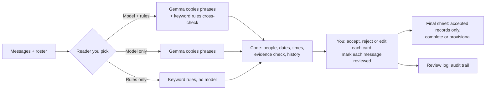

# Availazy

**Local AI for Coordinators Who Have Better Things to Do.** Let AI read. You decide.

Availazy was called Availability Ledger until 2026-10-22 (BRAND-01). The repository and Render service keep their existing `availability-ledger` identifiers; the Sentry organization remains `availability-ledger` and its project remains `python`. Older records in this repository use the old product name.

A local review tool for volunteer coordinators who collect availability through ordinary messages. You paste a week of dated chat messages and your volunteer roster; the tool suggests availability records, shows each one beside the message it came from, and keeps a per-person, per-day history of offers, corrections, cancellations and conditions. You review the suggestions, explicitly mark each message reviewed, and export a reconciled final sheet built from accepted records. A separate review log preserves the record trail.

It records **availability** (when people say they can or cannot help), not shift assignments.

**A local open model proposes and ordinary code decides.** The model (Gemma 4 E2B through Ollama) only copies phrases such as "next Tuesday", "after 3" or "if needed". Python code turns them into dates and times, checks each suggestion's words against the message and flags or drops unsupported ones (with one documented gap: a real quote with invented day or time words is only flagged and counts on the provisional sheet), keeps each person's history per day, keeps conditional offers conditional, and does every count. In the core workflow your messages go only to programs on your own computer (127.0.0.1); optional tracing, off by default, sends timing metadata, never message content.



The illustrated guide at `/docs` (served by the app; also on the hosted replay) walks through each step with diagrams; their sources are listed in [docs/DIAGRAMS.md](docs/DIAGRAMS.md).

Status: validation prototype. Every message, name and organisation in `fixtures/` is **fictional**. No real-coordinator pilot or measured human time saving is recorded. Read [context.md](context.md) and [CLAUDE.md](CLAUDE.md) before changing the project.

## Example (fictional)

```
2026-11-02 09:41 | Ana Example | I can do Tuesday 2-5. Thursday mornings too
2026-11-04 18:10 | Ana Example | Can't do Thursday after all, sorry
```

With the week of Monday 2026-11-09 selected and the **Rules only** reader (checked on 2026-10-20), the tool suggests Tuesday 10 Nov 14:00–17:00 and Thursday 12 Nov 09:00–12:00 from the first message and Thursday unavailable from the second. The sheet ends with Tuesday 14:00–17:00 only, and **Changes over time** lists "m02 Wed 04 Nov 18:10: Ana Example, Thu 12 06:00-23:00 marked unavailable, cancelled", linked to the message.

## Current capabilities

Implemented (which items are verified, and how, is in [PROGRESS.md](PROGRESS.md#capabilities)):

- Paste text or upload a `.txt`, in `YYYY-MM-DD HH:MM | Sender | text` lines or a WhatsApp export (Android or iOS, month-first or day-first).
- Roster of up to 20 volunteers; similar names are flagged and short names that match several people are left unresolved, never guessed (a short name matching only one person resolves).
- Three readers: **Model + rules cross-check** (default), **Model only**, **Rules only** (no model needed).
- Day and time phrases resolved in code: relative days, "next/this" weekdays, numeric dates, ranges, "after 3", "4 onwards", morning/afternoon/evening, "the same" (within one message). Ambiguous days are shown with their candidates, not guessed.
- Suggestions beside their source message with the quote highlighted; warnings in plain English. Suggestions with neither their quote nor their day/time words in the message are not applied unless you choose "Use it anyway" (a real quote with invented day/time words is only flagged; see Limitations).
- **Visible extraction failures (COR-03):** if a message's request fails or the model's reply cannot be read, that message shows a warning, reading continues with the next message, and the run reports how many messages could not be read fully. A failed message is never offered "Accept all and mark reviewed".
- Accept, reject, edit (volunteer, days, times, status, condition), reset or add records; "Accept all suggestions without warnings"; keyboard review (J/K move, A accept, R reject, E edit, M mark the message reviewed, Esc leave a field).
- Repeated messages (same sender, same text within 24 h) are collapsed and shown as "Same as mXX".
- **Needs a decision** list, half-hourly **People available** chart, **Availability sheet**, **Changes over time**.
- **Provisional vs accepted display (UI-05):** sheet segments backed by any suggestion not yet accepted have a dashed outline and a "pending" label; "pending change" marks a day where a pending suggestion cancels or replaces availability; the chart stacks accepted and pending layers; both panels say **Provisional** until the final export would be complete. The sheet fits its panel at desktop and phone widths, switching to one card per volunteer when narrow (UI-01).
- **Possible missed change (COR-07a):** when a later message from the same person contains a general-English change word (cancel, can't, drop, skip, scratch, …) and names a day on which they still have open time, but no suggestion from that message touches that day, **Needs a decision** shows "Possible change not applied (mXX mentions <day>)". It is a warning only: it never edits the sheet or the export.
- Explicit message review marks; **Accept all and mark reviewed** appears only when every undecided suggestion in the message is unflagged and fully resolved.
- A confirmed **final-sheet CSV** (complete or clearly provisional, COR-01) and a **review-log CSV**; in both, cells that a spreadsheet would run as a formula (starting with `=`, `+`, `-`, `@`) are written with a leading apostrophe (COR-02).
- **Landing page (UI-09):** `/` introduces the project, with a step-through of four demo-week messages becoming the sheet as the replay reads them; the review app is at `/app`. System fonts and inline SVG only: it loads nothing from another site.

## Limitations

- Review work lives only in the browser tab; reloading or a successful re-run replaces it. A re-run that fails (bad week, parse error, no dated messages) keeps the current review unchanged.
- The review-log CSV is an audit trail, not the final sheet, and cannot be replayed into it; use **Export final sheet** for the reconciled result. A message with no suggestions can be marked reviewed only with its button (J/K move between suggestion cards).
- A suggestion whose quote is real but whose day or time words are not in the message keeps its flag ("Some words are not in this message") and still counts on the provisional sheet until you accept or reject it; it is listed under **Needs a decision** as "Check the wording" and never reaches the final export unless accepted (COR-10, flag only per [D-30](docs/DECISIONS.md#d-30-cor-10-flag-unsupported-phrases-do-not-hold-them-keep-cor-07a)). The flag checks exact words, so it also appears when the model only reworded a day or time ("Wed" → "Wednesday").
- Pending suggestions count on the in-app sheet and chart (marked as pending); only the final-sheet export is limited to accepted records. Adjacent accepted and pending time ranges that the ledger merges are shown wholly as pending.
- A failed extraction request is not retried; read that message yourself.
- The timezone field is stored but not used; timestamps are read as written.
- Point times ("at 9") are not read. Names not on the roster are never applied.
- Accuracy figures come from fictional messages only; human time saved has **not** been measured.

Full list: [docs/ARCHITECTURE.md §14](docs/ARCHITECTURE.md#14-known-technical-limitations) and [TASKS.md](TASKS.md).

## Prerequisites

- macOS or Linux with Python 3.10+ (stated requirement; the unit tests have been run on Python 3.15 and 3.12 on macOS, and CI is configured for 3.12). Standard library only: nothing to `pip install`.
- A modern browser (checked with Chrome).
- For the model readers only: [Ollama](https://ollama.com) and the `gemma4:e2b-it-qat` model (about 4.3 GB download; about 1.6 GB of memory once loaded, recorded on an 8 GB Mac). **Rules only** needs neither.

## Quickstart

```bash
cd availability-ledger
python3 server.py                 # open http://127.0.0.1:8765/app (or: python3 server.py 8780)
```

The root address, http://127.0.0.1:8765, is the landing page; its button opens the app.

1. Click **Load fictional demo**.
2. Choose **Reader → Rules only** (works without Ollama) and click **Suggest records**.
3. Review the cards and mark each message reviewed (or use **Accept all and mark reviewed** where offered), then **Export final sheet (CSV)**.

To use the model readers, in another terminal first:

```bash
ollama serve
ollama pull gemma4:e2b-it-qat     # one-time download; only if not already installed
```

The page's **Model** list shows whatever Ollama has installed. If Ollama is not reachable, the page says so and only **Rules only** works.

## Configuration

The local app needs no environment variables. [.env.example](.env.example) is a shell-compatible template; keep your local values in the ignored `.env`. Its defaults select local mode (`LEDGER_DEMO=0`) and disable tracing (empty `SENTRY_DSN`). `server.py` does **not** automatically load `.env`.

For a new checkout, create the local file without overwriting an existing one:

```bash
cp -n .env.example .env
chmod 600 .env
```

To load it and start a local server on port 8780, run this from the project directory:

```bash
(
  set -a
  source ./.env
  set +a
  python3 server.py 8780
)
```

The subshell exports the settings only for that server session. Use port 8765 instead, or omit the argument, for the default port. An empty `SENTRY_DSN` keeps tracing off; a real value enables opt-in tracing only with the optional SDK installed (see [Opt-in tracing](#opt-in-tracing-sentry)). `LEDGER_DEMO=1` enables the hosted fictional replay and makes `PORT` apply; it is not needed for local use (see [Hosted replay](#hosted-replay-render)). Other configuration is:

| Setting | Where |
|---|---|
| Port | first argument to `server.py` (default 8765); the host is always 127.0.0.1. Demo mode only: `$PORT` on 0.0.0.0 |
| Week (a Monday), timezone label, reader, model, day-first WhatsApp dates | the page |
| Ollama address | fixed in `ledger/model.py` (`http://127.0.0.1:11434`) |
| Default model | `DEFAULT_MODEL` in `ledger/model.py` |
| Day start/end (09:00–20:00) and period hours | `Calendar` in `ledger/resolve.py` (not exposed in the UI) |

## Reviewing and exporting

Each message appears on the left with its suggestions on the right. Warnings (yellow) mean "check this"; grey badges are informational. Editing any field marks the suggestion accepted. Work through **Needs a decision** for unresolved people, ambiguous days, unreadable times, same-message conflicts and open conditions.

Each message also has **Mark message reviewed** (keyboard `M`). Marking is always explicit: deciding every suggestion does not mark a message. **Accept all and mark reviewed** appears only for eligible pending suggestions with a resolved person/day, readable time and no blocking warning; approved informational flags are allowed. The line above the list shows how many messages are marked, whether the final sheet would be complete, and how many messages could not be read fully.

Two exports:

- **Export final sheet (CSV)** (`availability-final-<week>-complete|provisional.csv`) contains accepted records only, replayed with corrections. It is **complete** only when every non-duplicate message is marked reviewed (the original covers its duplicates), nothing is pending and no blocking issue (unresolved person, unclear day, unreadable time, same-message conflict) is open; otherwise it is labelled **provisional**, and affected person/days are marked `needs_review`. An unreviewed message with unknown scope keeps the whole file provisional even if no cell can be marked. Accepted conditional offers remain conditional and do not by themselves prevent completeness. Format: [docs/specs/final-export.md](docs/specs/final-export.md).
- **Export review log (CSV)** lists reviewed records in message order with their source and warnings. It is an audit trail, not the final sheet. Columns: [docs/API.md](docs/API.md#csv-export).

The status line then shows review time and counts of accepts, edits, rejects, additions, bulk actions and messages marked.

## Local and online behaviour

| | Today |
|---|---|
| Messages, roster, review decisions | retained in browser memory and processed transiently by the local Python server on 127.0.0.1; no application persistence |
| Model calls | only to Ollama on 127.0.0.1 |
| Telemetry, analytics, crash reports | none by default. Opt-in Sentry tracing only when you set `SENTRY_DSN` and install the optional `sentry-sdk`: client-side allowlisted operational metadata with content excluded; received-cloud privacy observations and limits are documented [below](#opt-in-tracing-sentry) |
| Hosted version | the read-only replay at https://availability-ledger-replay.onrender.com (fictional set A, saved outputs; below) |

## Hosted replay (Render)

**Live:** https://availability-ledger-replay.onrender.com (free instance: after 15 minutes without visitors it sleeps, and the first visit takes about a minute to wake it). The root is the landing page and the replay itself is at https://availability-ledger-replay.onrender.com/app (UI-09; served since `a4bebb7`).

`LEDGER_DEMO=1 python3 server.py` starts a **read-only replay** (DEP-02, D-33). It listens on `0.0.0.0:$PORT` and serves only fictional set A. Suggestions come from the saved Gemma 4 outputs in `evaluation/runs/gemma4_e2b_it_qat_prompt3/`, by message ID, and Ollama is never called. The paste box and file upload are hidden, and the server refuses (403) any message, roster, week or model it did not serve. Review, accept and reject, history, warnings, the chart and both CSV exports work as locally. A banner on every page says it is a replay and links here. Without `LEDGER_DEMO` nothing changes.

**Deploying (owner steps, Render dashboard):**
1. Sign in to Render and choose **New → Blueprint**.
2. Connect this GitHub repository. Render reads [render.yaml](render.yaml): one free web service, Python 3.12.6, no install step, start command `python3 server.py` with `LEDGER_DEMO=1`, health check `/api/status`. There are no secrets to enter.
3. Check that the plan shown is **Free** and that no payment method is required, then apply. The first deploy prints the service URL.

**Free tier behaviour** ([render.com/docs/free](https://render.com/docs/free), read 2026-10-21):
- **Sleep:** the service spins down after 15 minutes without traffic. The next visit wakes it, which takes about one minute, so open the URL once before a demo.
- **Hours:** a workspace gets 750 free instance hours a month. After that, free services are suspended until the next month.
- **Overages:** bandwidth and build-minute overages are **billed if a payment method is on file**. Without one, Render suspends the services for the rest of the month instead. For ₹0, add no payment method.

## Opt-in tracing (Sentry)

Off unless you turn it on. The app itself needs no packages; tracing uses the optional `sentry-sdk`, pinned in [requirements-tracing.txt](requirements-tracing.txt), installed into a project virtualenv:

```bash
python3 -m venv .venv && .venv/bin/pip install -r requirements-tracing.txt   # once; nothing is installed globally
read -rs SENTRY_DSN && export SENTRY_DSN        # paste your project's DSN; it stays out of shell history
.venv/bin/python server.py                      # prints "Sentry tracing on: ..." when it is active
```

For this owner, hidden-input attempts did not reliably activate tracing; the working private clipboard alternative and its copy-overwrite pitfall are in the [Sentry handoff](docs/SENTRY_HANDOFF.md). Do not print the DSN to diagnose startup.

**What is sent**, for each run of **Suggest records**:
- One agent span (`invoke_agent availability-reader`) with the reader, model name, prompt version and number of messages.
- One `chat <model>` span per model call: duration, Ollama's load time, prompt and output time, input/output token counts, whether the reply was valid JSON, the number of suggestions, the message's **position** in the run, and an error category (the exception's class name) if the call failed.
- Spans for the hybrid merge, resolve, ledger build and export, with their durations and counts.

**Excluded by the application before transmission:**
- message text, quotes or excerpts;
- names, rosters, message IDs;
- prompts or model replies;
- exception messages, logs, breadcrumbs or error events;
- request bodies, host name or user details.

Two allowlists in `ledger/tracing.py` guard what leaves the process. The SDK's `before_send_transaction` hook (`scrub()`) rebuilds each transaction and its spans. A wrapper around the SDK's transport (`clean_envelope()`) rebuilds every envelope item just before it is sent, including the model-call spans the SDK sends as separate streamed items, and drops every other item type. Either one alone stops a leak. The SDK's default integrations are off. Tests with invented names, phone numbers and addresses check both layers ([TESTING.md](TESTING.md#opt-in-tracing-int-03)).

**Received-data boundary:** Sentry can enrich received records beyond the application payload. Earlier owner traces exposed `user.geo` values. After project IP/sensitive-field settings, a new fictional trace showed four geo values as `[Filtered]` on inspected chat/parent attributes, with no content in the chat Input/Output tabs. This verifies that bounded check, not every stored payload or retroactive removal. Setup/clipboard instructions, exact evidence, free-plan/trial distinctions and remaining checks are in the [Sentry handoff](docs/SENTRY_HANDOFF.md). Startup saying tracing is on proves initialization, not delivery.

- **Not traced:** the hosted replay, which makes no model calls and ignores `SENTRY_DSN`, and the app without the DSN or the package.
- **Cost:** inference is local, so there is no per-token charge ($0 per token). Sentry's free plan limits apply; this app sends a few hundred spans per run.

## Week 3 scope, work order and costs

**Scope ([D-33](docs/DECISIONS.md#d-33-owner-override-of-d-23-add-copilot-actions-render-sentry-and-elevenlabs)):** the DEV Hacktoberfest Week 3 entry targets **overall + Gemma**, plus GitHub Copilot (through GitHub Actions automation), Render and Sentry Agent Tracing; ElevenLabs was dropped ([D-37](docs/DECISIONS.md#d-37-drop-elevenlabs-int-04-demo-narrated-live-or-captioned)). Each one is named in the submission only if it is genuinely in use by then. Not planned for this entry: `.tech` routing, Entire, Copilot coding-agent work, Backboard R-CLI. Roles and gates: [docs/INTEGRATIONS.md](docs/INTEGRATIONS.md); rules: [docs/COMPETITION.md](docs/COMPETITION.md). An entry can win at most one prize.

| Technology | Status |
|---|---|
| Gemma 4 E2B via local Ollama | **Implemented.** Phrase extraction, cross-checked by rules and reviewed by a person. |
| Render read-only replay | **Deployed** (DEP-02, 2026-10-21): https://availability-ledger-replay.onrender.com, from [render.yaml](render.yaml) on the free plan. |
| GitHub Actions (Copilot category) | **Running** (`.github/workflows/tests.yml`, INT-10, INT-11): on every push and pull request, unit tests, a SHA-256 check that the frozen evidence is unchanged, and a re-score of sets A, B and C from saved outputs, with the score table in the job summary. No secrets or model. Latest observed run: "tests #17" on `a4bebb7` passed all three jobs (2026-10-22). |
| Sentry Agent Tracing | **Real delivery verified** (INT-03, 2026-10-21/22): four 300 s timeouts identified, later successful retry received, and targeted geo redaction verified on a separate fictional trace. Wider privacy/account checks remain open; [handoff](docs/SENTRY_HANDOFF.md). |
| ElevenLabs | **Dropped** ([D-37](docs/DECISIONS.md#d-37-drop-elevenlabs-int-04-demo-narrated-live-or-captioned)): not used, category not claimed. |
| Everything else listed above | **Deferred**; not implemented. |

**Work order ([TASKS.md](TASKS.md#order-of-work)):** done: set C scored once (EVAL-07, 2026-10-21); post-hoc fixes COR-13 to COR-18; GitHub Actions automation (INT-11); hosted replay (DEP-02). In progress: Sentry tracing (**INT-03**: real delivery/finding verified; scoped privacy/account checks remain) → demo recording (**DEP-03**; short local live-model check passed 2026-10-23, recording remains) → submission post (**REL-05**; the owner checks eligibility, **REL-04**). A small fresh set D (**EVAL-11**) is optional.

**Costs:** additional spending stays at **₹0**: existing resources, verified free plans or confirmed sponsor credits only, with no automatic upgrades, top-ups, paid fallbacks or renewals. CI runs on GitHub-hosted runners within the account's free allowance.

## Evaluation summary

On fictional held-out messages (set A: 20 messages, 30 units; set B: 20 messages, 35 units), at first (frozen) scoring ([evaluation/RESULTS.md](evaluation/RESULTS.md)):

- Rules alone: 20/30 and 17/35 units right, with many silent errors.
- Gemma alone: 20/30 and 28/35; it left 7 of 12 set A cancellations on the final sheet (a ledger figure computed over all 50 set A messages, dev included).
- Gemma + rules: 26/30 and 30/35; no cancellations left on either final sheet (the set B result was partly luck).

Changes made after reading held-out errors moved these numbers, some up and some down; they are labelled post-hoc and are not independent evidence. Two metric definitions were also corrected on 2026-10-20: duplicate messages are no longer counted as missed units (EVAL-10), and a condition interval that is only partly lost now counts as an error (EVAL-09); the before/after tables are in [PROGRESS.md](PROGRESS.md). The same author wrote the fixtures, references and rules. **Independent set C** (24 fictional messages written by an isolated ChatGPT session, 5 rewritten by the owner, scored once on 2026-10-21): Gemma + rules got 17/20 units right but only 0.527 final-sheet slot agreement with 2 of 8 cancellations missed. Rules alone scored 15/20 and 0.433; Gemma alone 17/20 and 0.403. The failures came mostly from deterministic reconciliation rules (explicit dates, replacement cues, settling conditions), not from the model ([evaluation/RESULTS.md](evaluation/RESULTS.md)). Fixes are in progress and will be post-hoc. Human time saved has **not** been measured: the final-sheet export and strict scorer exist, but the timing study (matched workloads, several participants) has not been run ([evaluation/MEASUREMENT.md](evaluation/MEASUREMENT.md)).

### Checks

Full list, per-file counts and what has and hasn't been verified: [TESTING.md](TESTING.md).

```bash
python3 -m unittest discover -s tests                 # 66 offline unit tests at commit c5a2e05; no model, no network (CI runs these)
python3 -m evaluation.compare                         # saved results; add "frozen" for first scoring
python3 -m evaluation.run --set A --extractor rules   # re-score with the rules reader; writes evaluation/results/
python3 -m evaluation.score_final my_final.csv --set A  # score a final-sheet CSV (timing study)
```

Optional browser checks drive the real page in headless Chrome with invented messages and the rules reader (no model calls). They need **Node 22+** (built-in WebSocket) and **Google Chrome**; on macOS the default Chrome path is used, elsewhere set `CHROME=/path/to/chrome`. They are not run in CI.

```bash
node tests/browser/session_rerun.mjs        # a failed re-run keeps the reviewed session and its export
node tests/browser/extraction_failures.mjs  # per-message failure warnings; reading continues
node tests/browser/csv_safety.mjs           # formula-like cells are neutralised in both exports
node tests/browser/sheet_display.mjs        # pending vs accepted display, chart layers, no overflow at 1400 px and 390 px
node tests/browser/review_safeguards.mjs    # wording check (COR-10) and possible-missed-change warning (COR-07a)
node tests/browser/landing.mjs              # landing page: demo steps, links, layout, nothing loaded from another site
```

Model and hybrid evaluation use per-message caches in `evaluation/runs/`, but a missing cache entry triggers a fresh model call even without `--refresh`; check cache coverage first ([CLAUDE.md](CLAUDE.md)).

## Documentation

| Document | For |
|---|---|
| [docs/PRD.md](docs/PRD.md) | problem, users, scenarios, requirements, metrics |
| [docs/ARCHITECTURE.md](docs/ARCHITECTURE.md) | how it works, data, boundaries, deployment |
| [docs/API.md](docs/API.md) | HTTP routes, import and CSV formats, CLI |
| [docs/specs/final-export.md](docs/specs/final-export.md) | final-sheet CSV format and scoring contract |
| [docs/DECISIONS.md](docs/DECISIONS.md) | why it is built this way |
| [docs/INTEGRATIONS.md](docs/INTEGRATIONS.md) | agreed technology roles, current status, privacy/budget gates and evidence |
| [docs/SENTRY_HANDOFF.md](docs/SENTRY_HANDOFF.md) | Sentry setup, evidence, lessons, privacy/billing limits and remaining checks |
| [docs/COMPETITION.md](docs/COMPETITION.md) | verified challenge rules, category eligibility, Week 1/2 research and strategy |
| [TASKS.md](TASKS.md) | backlog |
| [PROGRESS.md](PROGRESS.md) | current status and evidence |
| [context.md](context.md) | persistent starting point and verified hand-off for agents |
| [AGENTS.md](AGENTS.md), [CLAUDE.md](CLAUDE.md) | discovery entrypoint and canonical detailed rules for coding agents |
| [evaluation/TUNING.md](evaluation/TUNING.md), [evaluation/MEASUREMENT.md](evaluation/MEASUREMENT.md) | prompt tuning log; human timing protocol |

## Layout

```
server.py, ui/       local review page at /app and landing page at / (no external libraries)
ledger/messages.py   parse dated text and WhatsApp exports; mark duplicates
ledger/names.py      roster matching; similar names are flagged, never guessed
ledger/resolve.py    day and time phrases -> dates and times (no model)
ledger/core.py       evidence checks, per-person history, conflicts, counts
ledger/export.py     confirmed final sheet: export and strict reader
ledger/model.py      Ollama call: copy phrases into JSON (schema-constrained)
ledger/rules.py      keyword baseline
ledger/hybrid.py     model + rules cross-check
tests/               offline unit tests; tests/browser/ optional headless-Chrome checks
.github/workflows/   CI: unit tests on push and pull request to main
evaluation/          scoring, cached model outputs, results, tuning and measurement notes
fixtures/            fictional message sets, rosters, references
```

## Licence

This application is released under the [MIT License](LICENSE) (owner decision, 2026-10-21). The [Ollama listing for gemma4:e2b-it-qat](https://ollama.com/library/gemma4:e2b-it-qat) identifies Apache 2.0 (checked 2026-10-20); the model licence does not grant a licence to this application code.
