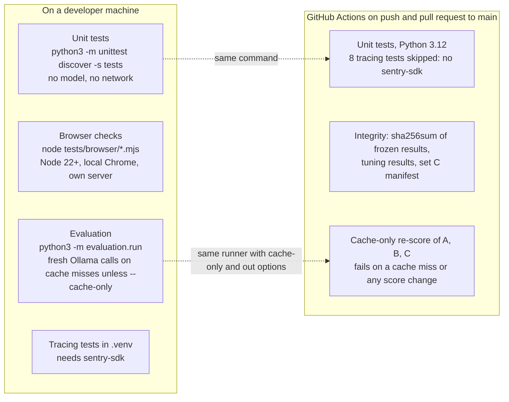

# Testing

How to check this project, and what has actually been checked. Written 2026-10-21. Counts are snapshots: re-run before you rely on them.

## How the checks fit together



Browser checks and model calls never run in CI. Frozen results are compared byte for byte; they are never rewritten.

## Unit tests (offline: no model, no network)

```bash
PYTHONDONTWRITEBYTECODE=1 python3 -m unittest discover -s tests
```

**At committed HEAD `c5a2e05`:** **66 tests pass** on Python 3.15.0 and 3.12 (macOS), verified 2026-10-21 in a clean `git archive` copy.

| File | Tests at HEAD | Covers |
|---|---|---|
| `tests/test_ledger.py` | 21 | Date/time resolution, names, ledger history; references A and B reproduce their `expected_sheet` (set C's was checked by the owner's script before freezing, not in this test) |
| `tests/test_export.py` | 30 | Accepted-only final sheet, explicit review, strict CSV reader/scorer, formula neutralising |
| `tests/test_evaluation.py` | 5 | Duplicate-aware unit scoring (EVAL-10), partial condition loss (EVAL-09) |
| `tests/test_review_safeguards.py` | 10 | COR-10 "check the wording" flag (no hold), COR-07a warning |

**Working tree, 2026-10-21 (INT-03, uncommitted):** **111 tests.** Without `sentry-sdk` (plain `python3` 3.15.0, and 3.12.6, also with `TZ=UTC`): 103 pass, 8 skipped. In `.venv` with `sentry-sdk` 2.72.0: all 111 pass. `tests/test_tracing.py` adds 13; see [Opt-in tracing](#opt-in-tracing-int-03).

**DEP-02 (committed `96fdfa7`):** **98 tests pass** on Python 3.15.0 and 3.12.6 (also with `TZ=UTC` on 3.12): `tests/test_demo_mode.py` adds 7 (demo routes over HTTP: pasted text, unserved or altered messages, other settings and other models refused; no model or Ollama call; replay claims identical to a local run fed the same saved outputs and to the cache-only evaluation reader; `LEDGER_DEMO=1` binds 0.0.0.0:$PORT, otherwise `PORT` is ignored).

**INT-11 (committed `8c5f975`):** **91 tests pass** on Python 3.15.0 and 3.12.6. Since `c5a2e05`: `tests/test_d31_fixes.py` (COR-13 to COR-18, 18 tests) and `tests/test_cache_only.py` (INT-11, 7 tests: `--cache-only` never reaches the patched model call, `--out` refuses protected folders, the CI summary fails on any score difference or fresh call).

**Working tree (uncommitted, 2026-10-21):** a new `tests/test_d31_fixes.py` for COR-13 to COR-17 brings the total to **81**. At 11:13 IST all 81 passed. That work is in progress and unreviewed (see [context.md §G](context.md#g-current-state-at-handover-2026-10-21-about-1115-ist)).

**CI:** see [CI (GitHub Actions)](#ci-github-actions).

## CI (GitHub Actions)

`.github/workflows/tests.yml` runs on every push and pull request to `main` (ubuntu-latest, Python 3.12). It has read-only token permissions, no secrets, no deployment and no Ollama. Its jobs are the GitHub Actions automation entered under the Copilot category (D-33).

| Job | What it does | Fails when |
|---|---|---|
| `unit` (INT-10) | The unit-test command above | Any test fails |
| `integrity` (INT-11) | `sha256sum --check --strict evaluation/protected.sha256` (every file in `evaluation/results/frozen/`, `frozen-setC/`, `tuning/` and `fixtures/setC.manifest`); then compares the folders' file list with the checksum list | A protected file changed, went missing or was added |
| `rescore` (INT-11) | For sets A, B and C: rules, then Gemma and Gemma + rules with `--model gemma4:e2b-it-qat --cache-only --out "$RUNNER_TEMP/rescore"`. Then `python3 -m evaluation.ci_summary` writes a table (units right on held-out messages, missed cancellations and slot agreement on the final sheet, fresh calls, "matches committed") to `$GITHUB_STEP_SUMMARY`. Last step: the checkout has no changes, so nothing is committed back | A saved model output is missing; any scoring field differs from the committed `evaluation/results/*.json` of the same name (run time, speed and memory are not compared); any fresh model call |

- **Consequence:** a commit that changes scores must also commit the re-scored `evaluation/results/*.json`, or `rescore` fails.
- **Changing a protected file:** `evaluation/protected.sha256` may only be regenerated after a recorded decision, never to make the check pass.
- **Run the same checks locally:**

```bash
shasum -a 256 -c evaluation/protected.sha256      # sha256sum -c on Linux
out=$(mktemp -d); for s in A B C; do python3 -m evaluation.run --set $s --extractor rules --out $out >/dev/null; for ex in model hybrid; do python3 -m evaluation.run --set $s --extractor $ex --model gemma4:e2b-it-qat --cache-only --out $out >/dev/null; done; done; python3 -m evaluation.ci_summary $out
```

**Runs observed:** "tests #1" on `56e38bd` (unit job only) passed (owner screenshot). The `integrity` and `rescore` jobs have **not yet run on GitHub**; locally (2026-10-21, macOS, Python 3.12.6 and 3.15.0, a copy of the working tree with ignored files left out) both pass, `rescore` takes under 2 s, and the checksum checks fail as intended on a modified frozen file and on an added file.

## Browser checks (optional, not in CI)

Need Node 22+ and a local Google Chrome (`CHROME=/path` to override). They start `server.py` and headless Chrome, install nothing, and use invented messages:

```bash
PYTHONDONTWRITEBYTECODE=1 node tests/browser/session_rerun.mjs
```

| Script | Checks | Last reported result (coding agent, 2026-10-20/21; not re-run by the lead) |
|---|---|---|
| `session_rerun.mjs` | A failed rerun keeps the reviewed session and export; a successful one starts fresh (COR-11) | 10/10 |
| `extraction_failures.mjs` | Per-message failure warnings and continued reading (COR-03) | 14/14 |
| `csv_safety.mjs` | Formula neutralising in both exports (COR-02) | 4/4 |
| `sheet_display.mjs` | Pending vs accepted display at 1400 px and 390 px (UI-05/UI-01/UI-07) | 28/28 |
| `review_safeguards.mjs` | "Check the wording" flag, the missed-change warning and the cue-replacement warning in the UI | 12/12 (re-run 2026-10-21, DEP-02) |
| `demo_mode.mjs` | Hosted replay with `LEDGER_DEMO=1`: banner, hidden inputs, pasted text refused, Model only and Model + rules from saved outputs, accept/reject, both exports, no page overflow at 1400 and 390 px. Optional `[screenshot-dir]` | 23/23 (2026-10-21) |
| `landing.mjs` | Landing page (UI-09) served with `LEDGER_DEMO=1`: nothing loaded from another site, every in-page link resolves, the hero demo plays to the final sheet and each step shows the right sheet, no page overflow at 1400 and 390 px, the button opens the replay at `/app`; locally (simulated status) the buttons say "Open the app". Since UI-10 also: the guide at `/docs` fits at 1400/390 px and unknown paths show the 404 page. Optional `[screenshot-dir]` | 18/18 (2026-10-22) |
| `harness.mjs` | Shared helper, not a test. Opens `/app` (the review app) unless a page is given | — |

**Release check (2026-10-22, working tree on top of `a4bebb7`, Sentry unset, Chrome 155):** all seven scripts pass: `sheet_display` 28/28, `demo_mode` 23/23 (exact banner copy updated for UI-11), `review_safeguards` 12/12, `session_rerun` 10/10, `extraction_failures` 14/14, `csv_safety` 4/4, `landing` **20/20** (now also 320 px for the landing page and the guide, with an element-bounds check that does not trust page width alone; it fails on the pre-UI-18 CSS). Unit tests: 116 run, OK (8 skipped without `sentry-sdk`, Python 3.15). A fresh clone of `origin/main` at `a4bebb7` gave the same 116/8 and passed every protected checksum. Scratch checks outside the repo (not reproducible from it): an invented-message import→review→export run, a bounded accessibility audit (UI-02) and a public Render/GitHub check; see PROGRESS.

**Final release review (REL-07, 2026-10-23, working tree on top of `a4bebb7`, `SENTRY_DSN` and `LEDGER_DEMO` unset, bytecode writes off, Python 3.15.0, Node 22.11.0, Chrome):** all seven scripts pass: `sheet_display` 28/28, `demo_mode` 23/23, `review_safeguards` 12/12, `session_rerun` 10/10, `extraction_failures` 14/14, `csv_safety` 4/4, `landing` 20/20. Unit tests: 116 run, OK (8 skipped without `sentry-sdk`). `shasum -a 256 -c evaluation/protected.sha256`: 17/17 OK; the CI protected-file inventory diff: no difference. CI-equivalent re-score of A, B and C (rules, then Gemma and Gemma + rules with `--cache-only`, temporary `--out`): 9/9 files match the committed results, 0 fresh model calls. `bash -n` and `zsh -n` on `.env.example`: OK. `git diff --check`: clean. `git status` identical before and after the checks. Not repeated: live inference (see below), a fresh clone, CI and Render for the release revision (after the owner pushes).

**UI-09 (2026-10-22, lead):** all seven scripts re-run after the app moved to `/app`: 28/28, 23/23, 12/12, 10/10, 14/14, 4/4 and `landing.mjs` 15/15. Unit tests: **115** run, OK (8 skipped without `sentry-sdk`, Python 3.15); `tests/test_pages.py` adds 4 (landing page at `/` also with a query string, app at `/app` and `/index.html`, other paths unchanged, no external loads in the landing page).

The agent also ran two checks kept in its own scratchpad, not in the repo: final export 13/13 and keyboard 18/18. They are not reproducible from the repo.

## Evaluation (accuracy on fictional data)

```bash
python3 -m evaluation.compare            # saved current tables (read-only)
python3 -m evaluation.compare frozen     # A/B first scores
python3 -m evaluation.run --set A --extractor rules
```

- **Fresh model calls on cache misses:** `evaluation.run` with `--extractor model` or `hybrid` calls Ollama whenever a cached output is missing, even without `--refresh`. Add `--cache-only` to make a miss an error instead (no model call, no memory sampling), and `--out DIR` to write results somewhere other than `evaluation/results/`. Confirm `evaluation/runs/<model>_prompt3[_setB|_setC]/` covers every non-duplicate message first.
- **Results get overwritten:** it overwrites `evaluation/results/*.json`. Never write into `frozen/`, `frozen-setC/` or `tuning/`.
- **Qwen is no longer installed** (2026-10-21). Its cached A/B outputs still allow cache-only re-scoring.
- **Set C** was scored once (EVAL-07, frozen in `evaluation/results/frozen-setC/`). Every later set C number is **post-hoc**.
- **Results and provenance:** [evaluation/RESULTS.md](evaluation/RESULTS.md).

## Final-sheet scoring (timing study)

```bash
python3 -m evaluation.score_final FILE.csv --set A
```

This scores a confirmed final-sheet CSV, from the app's **Export final sheet** or a manual sheet filled in from `evaluation/final_sheet_template.csv`. The study protocol is in [evaluation/MEASUREMENT.md](evaluation/MEASUREMENT.md). **No human timing has been run.**

## Opt-in tracing (INT-03)

```bash
.venv/bin/python -m unittest tests.test_tracing -v      # all 13; needs requirements-tracing.txt in .venv
python3 -m unittest tests.test_tracing -v               # 5 run, 8 skipped (no sentry-sdk), as in CI
```

| Test | What it proves |
|---|---|
| `Scrub` (2) | `scrub()`, the transaction allowlist, drops everything not listed: tags, extra, user, request, breadcrumbs, host name, other contexts, unknown span data, and free-text values in allowed keys. Runs without the SDK |
| `OffByDefault` (3) | No `SENTRY_DSN`: every call is a no-op and `sentry_sdk` is never imported. `SENTRY_DSN` set but `sentry_sdk` hidden: the server still works. Demo mode starts before tracing is initialised |
| `NoContentLeaves` (2, needs the SDK) | The real server, over HTTP (a 3-message run, one failed model call, then resolve and export), and `evaluation.run`, traced into a capturing test transport with **no DSN and no network**. Invented sensitive strings: a name, a phone number and an address in the messages, plus prompt, reply, error and log markers. The test also simulates careless future instrumentation: message text in span data, tags, user, extra, breadcrumbs and an error event. On the streamed chat span it adds an unapproved key through `Handle.set` and through raw `span.set_data`, and message text under an approved key. **None of these strings appear** in any envelope byte, and neither do message IDs or the run token. The test also checks the structure: one agent span per run, a `chat <model>` span per model call with tokens and load time, `error.type` only on the failed call, and the ledger stage spans |

| `EachAllowlistAlone` (6, needs the SDK) | A chat span carrying unapproved keys (`Handle.set` and raw `set_data`), prompt text and a message-text value under an approved key. It is checked with both layers on, with only the transport cleaner (`transaction_hook` off), and with only the transaction hook (`clean_envelope` off; a canary for the SDK's ordering): no leak in any of them, and tokens, load time and position kept. With **both off the strings appear**, which shows the SDK itself does not drop them. `clean_envelope()` is also tested on a crafted envelope: junk attributes, foreign names, bad IDs, an error event and an attachment. A last test confirms the pinned options: `trace_lifecycle="static"`, no `before_send_span`, `stream_gen_ai_spans` on, and the cleaning transport installed |

**Mutation checks (2026-10-21), on `NoContentLeaves`:**
- With `clean_envelope` alone switched off: passes.
- With `transaction_hook` alone switched off: passes.
- With both switched off: fails, because the fake name and the other strings appear.

So each layer alone is enough, and the test detects a leak.

CI runs the suite without `sentry-sdk`, so the 8 SDK tests are skipped there. Run them in `.venv` after any change to tracing.

## Record real traces

**Current evidence, 2026-10-22:** owner-operated fictional runs have reached Sentry. Setup/delivery no longer needs proving by another full demo. See the [Sentry handoff](docs/SENTRY_HANDOFF.md) for exact trace IDs, timeouts, successful retry, bounded privacy test, commands, screenshots/log provenance and limits. Earlier unit/leak-test results above remain dated historical checks, not fresh tests of the provider's received payloads.

- Initial run: UI 1,616 s; trace c26d2afd, 49 calls / four 300 s TimeoutErrors.
- Successful traced retry: UI 86 s; trace 969d7ee9, 1.42 min / 49 calls / 0 errors. The separate 85 s retry is local evidence only; tracing startup/delivery was not verified.
- Post-setting one-message trace bc88af7a: root 16.39 s, inspected chat/parent geo values `[Filtered]`, chat Input/Output tabs show no content. Remaining surfaces/raw payloads were not all inspected.
- Owner confirmed stopping Python/Ollama and unsetting DSN. This is conversation evidence, not a process/environment check.

For a separately authorized future check, the owner uses **Settings → Projects → python → Client Keys (DSN)** privately; the agent must never inspect the DSN, clipboard or secret environment. The local `.venv` already had SDK 2.72.0; do not reinstall or redownload merely to repeat setup. The handoff documents the working owner-only `pbpaste` export and its clipboard-overwrite pitfall. Require the tracing-on startup line, then verify the matching received trace; the startup line alone is insufficient.

**Bounded privacy procedure:** preserve existing real configuration entries, verify IP prevention/sensitive-field settings, allow the documented propagation interval, then use at most one invented message when a new event is actually needed. Inspect the matching chat and parent attributes and content tabs. Record filtered values versus absent keys precisely, exclude personal values from evidence, and keep uninspected surfaces explicit. Prefer inspecting existing traces over additional inference.

A controlled cold/warm or memory comparison remains a separate experiment, **not performed by these owner runs**. Restarting services/closing apps and warming the model changed several conditions. Do not ask the owner to repeat two 50-message runs by default or publish a causal speedup from this history. The app's `$0` token estimate is not a billing/hardware/energy audit. Actual free-plan, trial and paid-checkout observations and official retention/exhaustion policies are in the handoff; do not activate payment/PAYG to test limits.

## Not tested

- Safari (no WebDriver response; automation settings not changed) and Firefox (not installed), 2026-10-22.
- Screen readers (VoiceOver not run). Contrast, keyboard order, focus and accessible names were checked automatically in Chrome on 2026-10-22 (UI-02).
- Python 3.10 and 3.11.
- Linux locally (CI covers Ubuntu with 3.12).
- Real messages.
- Live model inference on a full week or with Model + rules. The only live check is the owner's two-message Model-only Chrome run with `gemma4:e2b-it-qat` on 2026-10-23 (CFG-02): correct suggestions and quotes, provisional then complete CSVs as expected. The 2026-10-22 and 2026-10-23 automated release checks made no model calls.
- Run-to-run model variation.
- The hosted replay beyond a read-only check: on 2026-10-22 its public pages returned 200 (404 for an unknown path) and served UI files byte-identical to `origin/main` at `a4bebb7`; its server code and Render's own logging were not inspected.
