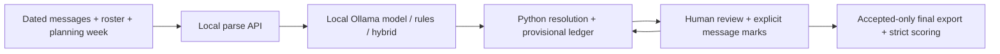

# Availability Ledger — persistent project context

**Read this file before modifying the project, then read [CLAUDE.md](CLAUDE.md).** This is the project's persistent handoff document and single starting point for understanding its purpose, verified state, decisions and next work across sessions and agents. Update it after any meaningful feature, dependency, API, architecture, evaluation, competition or status change.

**Audit date:** 2026-10-20, Asia/Kolkata (IST); project-lead plan added 20:45 IST (see §9). **Scope:** current local working tree, prior source/competition/history research and the latest owner-requested all-document alignment. The working tree differs from committed HEAD 4c1f700. This latest task changes documentation only, including the comments-only .env.example; no application code or evaluation data is changed. Status and counts are snapshots to recheck.

Use these labels: **Verified** = inspected evidence or a check run in this audit; **Implemented** = present in source, with verification scope stated; **Planned** = agreed backlog; **Proposed** = optional/not selected; **Unconfirmed** = evidence missing or conflicting. No implementation task was observed marked in progress. Actual source/tests establish behavior; official competition rules establish contest requirements. If either contradicts this file, investigate and update this file rather than changing code to satisfy stale prose. [PROGRESS.md](PROGRESS.md), [TASKS.md](TASKS.md) and the detailed documents remain supporting evidence; remaining limitations and decisions are listed below.

## 1. Product, users and intended outcome

**Availability Ledger** is a local, single-user review tool for one volunteer coordinator reconciling a planning week for up to 20 volunteers. People send ordinary messages, then correct, cancel or qualify their offers. The coordinator otherwise has to reread the conversation and edit a spreadsheet. The costly failure is a silently missed cancellation or condition.

The tool accepts dated messages and a roster, proposes source-linked availability records, lets a person review them, maintains per-person/day history, and exports the reconciled final availability. **Availability is not shift assignment.** Assigning rotas, contacting volunteers, automated chat ingestion, accounts, collaboration and cloud synchronization are outside the current scope. Volunteers do not need to adopt a new app.

**Core decision:** a local open model copies phrases; Python resolves identities, dates, times, evidence, corrections and counts. Expected benefits are less retyping and fewer silent errors while keeping messages local. **These are goals, not measured real-world outcomes.** The current stage is a validation prototype, not a public service.

**Problem evidence is weak:** the PRD cites one anecdotal [r/nonprofit scheduling post](https://www.reddit.com/r/nonprofit/comments/1apjpbc/volunteer_scheduling_help/); a previous reviewer could not reopen it. No coordinator interviews, real-user pilot or independent reference review are recorded. Fixtures and tests are fictional and were largely written by the same author as the rules/reference answers. See [PRD](docs/PRD.md).

## 2. Agreed competition direction and technology roles

**Owner objective:** maximize legitimate winning opportunities while preserving a useful coordinator product, local privacy and additional spending of ₹0. The owner selected a coherent multi-category planning direction; optional technologies are not implemented and this documentation request does not authorize activating them.

Canonical full references:

- [docs/COMPETITION.md](docs/COMPETITION.md): official rules/all 20 sponsor categories, date conflict, crowding sample, complete Week 1 award roster, selected winner/Week 2 project analysis, strategy, provider feasibility sources and unknowns. All detailed research previously in this section is preserved there.
- [docs/INTEGRATIONS.md](docs/INTEGRATIONS.md): each technology's role/current state, privacy and free-budget contracts, implementation evidence, rollout, stop conditions and remaining decisions.
- [docs/DECISIONS.md](docs/DECISIONS.md): D-22 accepts the direction only; D-11 remains the current dependency/network boundary. [TASKS.md](TASKS.md) owns task status and dependencies.

### Confirmed competition facts and unresolved dates

The primary contest is [DEV Hacktoberfest Week 3](https://dev.to/challenges/hacktoberfest-week3-2026-10-19), theme **Slow and Steady**, with open-source AI at its core. Overall is $250; six featured awards are $200 each and fourteen partner awards $100 each: **21 awards/$2,850**. Sponsor categories are optional award opportunities, not separate product prompts. One genuine entry may qualify for multiple categories but can win only once. Writing quality is weighted most heavily; theme, creativity, technical execution and meaningful partner use also matter.

Written rules say October 25, 11:59 PM PDT (**October 26, 12:29 PM IST**). Raw event API end_time remains October 25, 06:59Z (**October 25, 12:29 PM IST**), one day earlier despite agreeing prose. Use the earlier date as the internal planning target until clarified, not as the written deadline. The last pass could not reopen the written-rules URL; keep its earlier inspected value and the source conflict explicit. Check personal eligibility, actual new-project start within the window, final code accessibility and submission requirements before release.

### Roles selected for planning

| Technology | Proper role | State / gate |
|---|---|---|
| Gemma / local Ollama | Availability phrase extraction; Python reconciles; human reviews final availability. | Implemented. Preserve open/local core and truthful evidence. |
| Copilot / GitHub Actions | Genuine needed development/review; separately evidenced CI automation. | Planned use, not verified. Check actual free access; never attribute another agent's work to Copilot. |
| Entire | Real upcoming sessions, checkpoints and decisions. | Planned, no captured sessions verified. Verify supported agent; inspect/redact before sharing. |
| Sentry Agent Tracing | Optional structural latency/error/token diagnostics and a genuine debugging finding. | Conditional proposal. Needs exact stdlib/network/privacy exception, fictional-first metadata allowlist, opt-in/default-off behavior and verified free hard stop. |
| Render | Useful interactive fictional saved-output review/export demonstration. | Planned, not implemented/deployed. Label replay, exclude private uploads, verify free limits; remote host cannot use the Mac's localhost Ollama. |
| bipulchamoli.tech | Domain/DNS address for that hosted demonstration. | Owner reports ownership; routing, promo acquisition and no-paid-renewal state unverified. A different project name is fine; prize eligibility still needs acquisition proof. |
| ElevenLabs | Narrate the fictional demo video. | Planned artifact, not generated. Verify free credit/plan and output rights; in-app voice/transcription remains deferred. |
| Backboard R-CLI | Optional bounded, useful development task with a compatible local model. | Proposed/untried. No Backboard runtime API, cloud memory or provider replacement is selected. |

Development tools, runtime diagnostics and demo-production tools are distinct. No new cloud database, auth, orchestration, hardware, fine-tuning or product voice is selected merely to enter a category. Conditional proposals may be dropped if they fail usefulness, compatibility, rights, privacy, budget or time gates. No optional installation, account, claim, integration, deployment or publication occurred in the documentation task.

### Evidence-led recommendation and historical lessons

Retain **overall + Gemma** as the strongest current implemented fit, not a proven best winning probability. Capture meaningful Entire/Copilot evidence through already-needed work. Sentry is a coherent extra technical opportunity only if real tracing/debugging fits its gates. Actions/narration are useful lightweight eligibility/presentation additions; Render improves judge access if a useful replay is feasible. Keep .tech conditional and R-CLI bounded.

Verified [Week 1 results](https://dev.to/devteam/congrats-to-the-hacktoberfest-open-source-ai-challenge-touch-grass-winners-152c) list 17 awards/$2,450. Inspected winning posts report concrete use, model/code boundaries, engineering/debugging and candid evaluation limits; these attributes are not proven causes of selection. Week 2 advertised 18 awards/$2,550, but no official results announcement was located as of October 20. Dabba, Doorman and RuleDelta are comparison submissions, not verified winners. Dabba also handles cancellation messages and owner corrections; these are not unique claims for this ledger. Demonstrate review/history/export guarantees and actual coordinator value.

No reliable per-category totals or judge scorecards were found. A 20-post convenience sample showed six explicit Gemma declarations and one Render declaration; incomplete declarations/feed ordering prevent extrapolation. New or unobserved categories are not established easier prizes. Exact sample IDs, limits, author-reported metrics and historical category changes are preserved in COMPETITION.md.

**Core work first:** freeze unseen C before further behavior changes → visible extraction failures/evidence protection → both CSV exports protected → independent evaluation/coordinator validation and matched timing where feasible → truthful demonstration/write-up. Capture genuine development evidence during necessary work. Award category count must not displace correctness or the highest-weighted writing/evidence.


## 3. What exists now

| Area | State and evidence |
|---|---|
| Input | **Implemented:** pipe-format dated text and WhatsApp Android/iOS exports, continuation lines, day-first option, roster parsing and fictional demo. |
| Readers | **Implemented:** Model + rules cross-check (default), Model only, Rules only. Gemma through Ollama is the only sponsor integration implemented. |
| Resolution | **Implemented:** roster matching, date ambiguity/candidates, ranges/open-ended times/periods, quote/phrase checks, same-message time reuse. Some unsupported phrases remain a known gap. |
| Reconciliation | **Implemented:** partial corrections, replacement cues, cancellations, conditions, conflicts, source-linked history and duplicate collapse. Extraction still misses some cancellations. |
| Review UI | **Implemented:** accept/reject/edit/reset/add, eligible bulk acceptance, J/K/A/R/E/Esc, explicit message review with M, sheet/chart/issues/history. |
| Confirmed export and scoring | **Implemented, Verified:** COR-01/EVAL-06; separate final-sheet and review-log exports; strict final-sheet scorer for both timing conditions. |
| Four corrective fixes | **Implemented, Verified:** COR-11 atomic reruns, COR-12 dropped/rejected scope exclusion, EVAL-08 partial condition loss and duplicate metadata rejection. |
| Visible extraction failures, formula protection | **Implemented, Verified (2026-10-20):** COR-03 per-message warnings and continued reading; COR-02 neutralises formula-like cells in both CSVs. Not committed yet. |
| Save/reopen | **Planned**, not implemented (deferred, D-23). |
| Hosted replay, narration, other sponsors | **Proposed/Planned**, not demonstrated; see category table. |

**49 offline unit tests pass in the latest docs audit:** 21 in `tests/test_ledger.py`, 28 in `tests/test_export.py`. The optional browser rerun check passed in the earlier source audit; it was not rerun in this docs pass. Verification scope is in §10. No human timing study or real pilot has been run.

## 4. Architecture and data flow

The app uses **Python standard library**, `http.server.ThreadingHTTPServer`, and vanilla browser JavaScript/CSS with no external frontend libraries. There is no database, application package manager, SDK dependency, CDN, build step or deployment configuration.



1. The browser loads the local page, queries installed Ollama models, and optionally loads fictional set A.
2. `POST /api/parse` sorts messages, assigns IDs and marks duplicates.
3. The browser requests extraction sequentially for each nonduplicate message; no earlier conversation is sent to the model.
4. Every five messages, at the end, and after edits, the browser sends the full session to `POST /api/resolve`.
5. Python resolves claims and builds the provisional ledger. Browser rendering shows quotes, issues, history, availability and headcounts.
6. `POST /api/export` recomputes the accepted-only final sheet and writes its CSV. The review-log CSV is built separately in the browser.

**State:** messages, raw claims/overrides, resolved claims, roster, calendar, review marks and counters live in browser memory and are processed transiently by the local server. No database, disk save, cookies for accounts or browser persistence is implemented. Reload loses work. Invalid settings, failed parsing or no dated messages preserve the previous session/export; a usable parse commits the new settings and resets the session together. A later extraction failure marks only that message with a warning and reading continues (COR-03).

**Ollama:** fixed `http://127.0.0.1:11434`; default `gemma4:e2b-it-qat`; prompt `PROMPT_VERSION = 3` in `ledger/model.py`. Requests use a JSON schema, temperature 0, seed 7, context 4096, `think: false`, no streaming, 300-second timeout and no retry. The model receives planning week, sent time, sender and message text; it does not receive the roster. The UI can select an installed model. Qwen3.5 4B was an evaluated comparison, not an additional current requirement; installed models were not probed in this audit.

## 5. Data structures and behavior to preserve

- **Message:** `id, sent, sender, text, duplicate_of`. JSON timestamps are `YYYY-MM-DD HH:MM`. Sort is stable; IDs are `m01` etc.
- **Raw claim:** `id, msg, n, source, review, said`, optional `override` and `hints`. `said` contains `person, day_text, time_text, status, condition, replaces_earlier, excerpt`. Sources include model/rules/user. Review is pending/accepted/rejected; the resolver may compute dropped.
- **Resolved claim:** adds roster identity and candidates, resolved/candidate dates, time span/state, evidence state/span, flags and drop reason. Reviewer overrides control that same claim; later independent pending claims may still change the provisional ledger.
- **Ledger:** `sheet, history, issues, review_notes, counts`. The sheet contains available/conditional segments; unavailable intervals are absent.
- **Calendar/grid:** selected Monday through Sunday; internal 15-minute slots from 06:00 to 23:00 (**68 per person/day**). Default unstated availability is 09:00–20:00; periods are fixed. The chart counts 08:00–22:00 at half-hour steps.
- **Dates/names:** ambiguous identity or dates are not guessed. Unique first-name prefixes can resolve; similar names remain flagged. Numeric dates use the planning week to disambiguate where possible.
- **Times:** ranges, morning/afternoon/evening, open-ended phrases including “4 onwards”; “the same” can reuse a prior range within the same message only. Point times such as “at 9” remain unreadable.
- **Corrections:** process chronologically. A later claim changes only covered time; `replaces_earlier` first clears that day's earlier answers. Same-message conflicts keep the cautious status and create an issue. Conditions remain conditional until actually settled.
- **Duplicates:** same normalized sender/text within 24 hours of the earliest copy; no additional extraction or reapplication, with repeated history. Duplicate-review coverage comes from the original message.
- **Coordinator handling:** a coordinator off the roster has self-claims dropped; a coordinator on the roster can volunteer normally. The optional API coordinator list is not exposed by the UI.

**Important distinction:** the **in-app sheet/chart include pending claims**. The final export includes accepted claims only. A real quote paired with invented day/time words can still affect the provisional sheet; COR-10 must address that. See [architecture](docs/ARCHITECTURE.md) and [decisions](docs/DECISIONS.md), especially D-13 (superseded behavior) and D-21 (export/scoring).

## 6. APIs and export/scoring contract

| Route | Purpose |
|---|---|
| `GET /api/status` | Available Ollama models and default model. |
| `GET /api/demo` | Fictional set A text/roster/calendar. |
| `POST /api/parse` | Text, roster and day-first flag to parsed messages/roster. |
| `POST /api/suggest` | One message plus roster/calendar/reader/model to pending claims and stats. |
| `POST /api/resolve` | Whole session, claims and `reviewed_messages` to resolved claims, provisional ledger and `confirmed` summary. |
| `POST /api/export` | Same session body to final-sheet summary, row count, filename and CSV text. |

The calendar payload uses `week_start` and `timezone`. Resolve/export also support optional `coordinators`. Unknown reviewed IDs are ignored and reported as `unknown_reviewed`. Unknown endpoints return 404; exceptions in POST handling become HTTP 400 JSON errors, including server/model failures.

The canonical file contract is [docs/specs/final-export.md](docs/specs/final-export.md); interfaces are in [docs/API.md](docs/API.md).

- Final sheet uses accepted records (including reviewer additions), replayed through ordinary ledger rules. Pending/rejected/dropped claims do not add or cancel final availability.
- **Message review is explicit.** Deciding all suggestions does not mark the message. M toggles the current card's message; messages without cards use their button. Combined acceptance/review is offered only for eligible pending suggestions with resolved identity/day and readable time; the approved informational-flag set is in the spec/UI.
- **Complete** requires all nonduplicate messages marked, no pending claims and no blocking `who/date/time/conflict` issues. `condition` and `outside` issues do not block completeness. Complete does not mean every offer is unconditional.
- Pending claims, blocking issues and accepted/pending claims of unreviewed messages mark affected cells `needs_review`. Dropped/rejected claims never define cell scope. Unknown scope keeps the entire file provisional until explicit review.
- UTF-8 filename: `availability-final-<week>-<complete|provisional>.csv`. First line starts `# availability-final v1;` with `week, status, unreviewed, pending, blocking_issues`; unreviewed IDs are space-separated.
- Columns: `volunteer,date,start,end,status,condition,cell_state,sources`. Rows describe available/conditional segments; absent availability has no row. An otherwise empty unresolved cell has a row with empty times/status. Claim IDs in sources are semicolon-separated.
- Strict parsing rejects duplicate metadata keys, contradictory complete status, wrong roster/week, invalid enums, times outside 06:00–23:00 or off the 15-minute grid, and overlapping contradictory statuses.
- `evaluation/score_final.py` reads final rows directly into slots. Provisional input is refused unless `--allow-provisional`; its report remains provisional and is not interchangeable with a complete result. Each unresolved cell contributes 68 disagreeing slots once and overrides any confirmed segments in that cell.
- Withdrawal and condition metrics describe **final-state errors**, not recognition of a particular cancellation message. Partial condition loss is detected in this scorer.
- `evaluation/final_sheet_template.csv` is for the manual study condition; fill its week and use provisional status for unresolved cells.
- The review log is an audit trail, lacks replacement semantics and **cannot reconstruct the final sheet**. `evaluation/score_csv.py` remains unsuitable for timing. Both timing conditions must submit final-sheet CSVs.

## 7. Repository map and development environment

| Path | Responsibility |
|---|---|
| [server.py](server.py) | Local static files and JSON APIs. |
| [ui/app.js](ui/app.js), [index.html](ui/index.html), [style.css](ui/style.css) | Browser session, review, keyboard, rendering and review-log export. |
| [ledger/messages.py](ledger/messages.py), [names.py](ledger/names.py), [resolve.py](ledger/resolve.py) | Input/duplicates, roster matching, calendar/date/time rules. |
| [ledger/core.py](ledger/core.py) | Evidence checks, resolved claims, ledger, history and counts. |
| [ledger/model.py](ledger/model.py), [rules.py](ledger/rules.py), [hybrid.py](ledger/hybrid.py) | Local model prompt/call, regex baseline and cross-check. |
| [ledger/export.py](ledger/export.py) | Confirmed sheet, CSV writer/strict reader; `_cell` is the final-export formula-protection hook. |
| [tests/test_ledger.py](tests/test_ledger.py), [test_export.py](tests/test_export.py) | Offline regression tests. |
| [tests/browser/session_rerun.mjs](tests/browser/session_rerun.mjs) | Optional real-browser failed/successful-rerun regression. |
| [evaluation/run.py](evaluation/run.py), [compare.py](evaluation/compare.py), [fixture.py](evaluation/fixture.py) | Extraction/ledger evaluation, saved-table comparison, fictional data loader. |
| `evaluation/results/frozen/`, `evaluation/results/tuning/`, `evaluation/runs/` | First-score evidence, tuning evidence and cached outputs; preserve unchanged. |
| `fixtures/` | Fictional A/B messages, rosters, reference answers and older manual-entry log template; no set C present. |
| [README.md](README.md), [PRD](docs/PRD.md), [DECISIONS](docs/DECISIONS.md) | Setup, requirements and rationale. |
| [AGENTS.md](AGENTS.md), [CLAUDE.md](CLAUDE.md) | Universal discovery entrypoint and canonical detailed agent instructions. |
| [COMPETITION](docs/COMPETITION.md), [INTEGRATIONS](docs/INTEGRATIONS.md) | Full source-backed contest/history research; agreed roles, contracts, gates and rollout. |
| [TASKS.md](TASKS.md), [PROGRESS.md](PROGRESS.md), [RESULTS](evaluation/RESULTS.md), [TUNING](evaluation/TUNING.md), [MEASUREMENT](evaluation/MEASUREMENT.md) | Backlog, evidence, provenance and study protocol. |

**Runtime:** README states Python 3.10+; this audit ran **Python 3.15.0 on macOS**. Earlier supported versions/platforms were not tested. The optional browser harness needs Node 22+ (tested v22.11.0) and local Google Chrome; it uses built-in APIs and installs nothing.

From this repository directory:

```bash
python3 server.py                         # http://127.0.0.1:8765
python3 server.py 8780                    # optional port
PYTHONDONTWRITEBYTECODE=1 python3 -m unittest discover -s tests
PYTHONDONTWRITEBYTECODE=1 node tests/browser/session_rerun.mjs
python3 -m evaluation.compare             # read saved current results
python3 -m evaluation.compare frozen      # read first-scoring results
python3 -m evaluation.score_final FILE.csv --set A
```

For a local demo, start the server, load fictional demo, choose **Rules only**, suggest records, review/mark messages, then export. Model modes additionally require an already installed/running Ollama and model; `ollama serve` starts that separate runtime. This documentation task did not install/download or run inference.

**Configuration:** port is a CLI argument; host is always `127.0.0.1`. The UI selects week, timezone label, reader/model and WhatsApp day-first parsing. Ollama URL/default model and calendar period hours are code constants. The application reads **no environment variables** and loads no `.env`; [.env.example](.env.example) is comments only. The optional browser harness alone reads `CHROME` to override its executable path; that is not application configuration.

## 8. Evaluation evidence and honest limits

All recorded benchmark data is fictional. **Set A:** 50 messages, 30 development + 20 held-out (30 held-out reference units). **Set B:** 20 held-out messages, 35 units. Extraction metrics are split-specific; ledger cancellation/slot metrics use **all 50 A messages including dev**, and all 20 B messages.

Selected Gemma + rules evidence, rechecked from saved tables:

| Snapshot | Held-out units correct | Silent errors | Whole-set missed withdrawals | Whole-set slot agreement |
|---|---|---|---|---|
| A first/frozen | 26/30 | 3 | 0/12 | 0.851 |
| A current, post-hoc | 24/30 | 5 | 0/12 | 0.876 |
| B first/frozen | 30/35 | 3 | 0/5 | 0.776 |
| B current, post-hoc | 31/35 | 4 | 1/5 | 0.925 |

Full rules/model/hybrid and Qwen comparisons: [RESULTS.md](evaluation/RESULTS.md) and [PROGRESS.md](PROGRESS.md). Current values derive from `evaluation/results/*.json`; frozen values from `evaluation/results/frozen/`.

Do not call current A/B results independent validation: cross-check design saw A held-out; later quote-day, modifier, duplicate and time changes saw held-out errors. B's first zero-missed-withdrawal hybrid result partly came from an unreadable earlier offer masking a missed cancellation. Duplicate references still count repeated units, so deduplication distorts extraction-unit scoring. Perfect reference-sheet scorer output tests the contract, not model accuracy.

**Open EVAL-09:** `evaluation/run.py` still misses partial condition loss in its ledger metric. The timing scorer `score_final.py` is fixed; do not describe the older metric as fixed or silently revise historical numbers.

**Human time saved is unmeasured.** Click/field proxies are not minutes. [MEASUREMENT.md](evaluation/MEASUREMENT.md) requires matched workloads (never 50-message A versus 20-message B), multiple participants, balanced condition/set order, equivalent final CSVs and the same scorer. Report active human time separately from unattended inference. The preset goal is assisted time at most 70% of manual, with agreement no more than 2 percentage points lower; it is a target, not a result. A fictional study tests mechanics; the protocol calls for a consented real-data round before real-world savings claims.

**Historical performance only:** saved prompt-v3 runs report Gemma median 2.45 s/message on A and 2.30 s on B; the earlier 50-message hybrid run was reported at 131 s. These were not remeasured. Ollama-reported model allocation (Gemma about 1.59 GB, Qwen 2.95 GB) is not total system memory. Fresh memory samples exist only for certain frozen/tuning calls; cache-replay snapshots do not measure inference memory. Qwen A's occupied swap grew about 1,242 MB; roughly 14.8 GiB was swap-out traffic. Gemma “2% free” and “4 GB first-load swap” have no backing file. Follow RESULTS provenance rather than repeating those notes as measurements.

## 9. Priorities, open issues and decisions

**Project-lead plan (2026-10-20, 20:45 IST; this supersedes the ordering below where they differ).** Canonical timeline: [TASKS.md § Order of work](TASKS.md#order-of-work). Decisions: [D-23–D-27](docs/DECISIONS.md#d-23-week-3-submission-scope-gemma-core-optional-actions-ci-other-integrations-deferred).

- **Week 3 scope (D-23):** overall + Gemma. Actions CI is optional and only if the core is finished by Thu 22 Oct 14:00 IST. Sentry, Render/.tech, ElevenLabs, Entire, Copilot agent work and R-CLI are deferred until after submission.
- **Owner actions tonight:** choose a licence (REL-01); commit and push the working tree, because the **public** GitHub repo is still at `4c1f700` without the export/scorer work (REL-06); write set C **outside the repo** following [the brief](docs/specs/eval-01-setC-brief.md), and commit only `fixtures/setC.manifest` (EVAL-01, D-24).
- **Then (implementation agent):** COR-10, COR-03 → COR-07a (a warning for possibly missed cancellations, D-25) → COR-02 → EVAL-09, EVAL-10 (duplicate-aware scoring, D-26) → EVAL-07 (score C once) → UI-05 → UI-01 → demo → post. Publish by Sat 24 Oct 21:00 IST.
- **Docs (D-27):** until submission, each task updates its TASKS row plus one dated PROGRESS entry; this file changes only when the plan or state changes.

**Prerequisite before further behavior changes:** EVAL-01 requires at least 20 new fictional set C messages and a handwritten reference to be frozen, unscored and committed before further behavior changes, without coding agents inspecting their contents. Arrange for a writer outside that implementation work to prepare them; this is the execution plan for preserving the unseen set. No set C files are present. This prerequisite is now explicit in the work order across TASKS, PRD and the agent guide. The already post-hoc A/B changes cannot be made independent retrospectively.

After that prerequisite, follow [TASKS.md](TASKS.md#order-of-work):

1. COR-03/COR-10: expose extraction failures and prevent unsupported pending day/time suggestions affecting the sheet.
2. COR-02: protect both CSV writers. If COR-07 is selected, use separately invented development examples without opening C.
3. Fix EVAL-09 partial-condition accounting in the older evaluator before final C scoring/publication, preserving historical numbers and labelling corrected snapshots. Then EVAL-07 scores C once after planned behavior changes; record the exact code/scorer version.
4. Coordinator feedback/authorized pilot (EVAL-03), independent reference review where feasible (EVAL-04), and matched timing (EVAL-02). Feedback can proceed in parallel; no time-saving claim until the study is actually run.
5. Useful fictional demo and truthful submission/write-up; optional tools pass their gates. REL-03 documentation/evaluation labels are done; UI-05 remains a separate useful task.

Next-work review (DOC-02, 2026-10-20) reconfirmed EVAL-01 as the immediate next task; C remains absent. COR-03 now explicitly includes invented/stubbed browser coverage for a failure between successful extractions, invalid JSON/hybrid behavior, consistent new-session state and provisional export until explicit review. This is planned coverage, not an implemented fix.

The owner agreed to the layered direction in §2 and the integration plan, not to activation of every optional tool. This does not replace the correctness/evaluation order or authorize implementation by itself. Low-effort eligibility must not be presented as demonstrated winning strength.

Other **Planned** work: COR-04 session save/load; COR-06 roster-limit warning; COR-08 coordinator UI; UI-01 sheet overflow; UI-02 accessibility verification; stop/cancel support and richer failure statistics. COR-05 timezone behavior/removal and COR-09 repeat-after-intervening-cancellation semantics need decisions. Extraction failures are now visible per message (COR-03) and both CSV exports are formula-protected (COR-02); failed requests are not retried.

**Owner/external decisions:** project licence; actual development start and personal eligibility; organizer deadline clarification; .tech acquisition/renewal; final sponsor categories; optional host/replay; coordinator interviews/pilot and independent reference review. No evidence establishes demand or whether reviewing is faster than a signup form/manual entry.

### Current Git, deployment and documentation discrepancies

**Verified:** a local Git repository exists on `main`, tracking `origin/main`, at `4c1f700`; configured origin is [bipul724/availability-ledger](https://github.com/bipul724/availability-ledger). There are 21 local commits dated 2026-10-20 IST, starting at `6d18968` (11:26:38 IST). Public accessibility/current remote contents were not verified.

The current export/scorer/tests/browser fixes and many docs/results changes are uncommitted; several new files are untracked. **A clone of committed HEAD will not reproduce this working tree's features.** Do not discard, stage, commit or push that work as part of a documentation-only task. Git history timing is evidence of commits, not proof of initial project creation.

No licence file, public app deployment or deployment configuration is present. Proposed DEP-02 is a fictional-data-only replay on free hosting, clearly labelled as saved outputs rather than live inference; a local video is also a permitted demo path. Render is the selected planning option; no hosting account, service or deployment was activated in this audit.

The all-doc alignment corrected stale Git absence, export-test counts, final-scorer status and omitted set C prerequisites. Complete competition detail was moved to COMPETITION.md rather than discarded. Current source/API behavior remains unchanged; future implementation must update the corresponding contracts and status when it actually lands.

## 10. Verification and audit provenance

| Check / provenance | Outcome and limit |
|---|---|
| Earlier source audit | Product/source/API/test/config/Git and saved evaluation evidence inspected. Historical server, browser and mutation-check reports remain in PROGRESS.md. No real .env/keys/pilot data read. |
| Latest docs pass: offline unit tests | PYTHONDONTWRITEBYTECODE=1 python3 -m unittest discover -s tests: **49 passed**, 21 ledger + 28 export/scorer, Python 3.15.0/macOS. |
| Latest docs pass: API input contract | 14 in-process reviewed_messages probes passed; tolerated falsy JSON values and rejection behavior documented exactly. No server/inference started. |
| Earlier browser rerun check | 10 assertions passed for failed/successful reruns and exports. Earlier final-export/keyboard checks reported 13/18. Not rerun in this documentation pass. |
| Saved evaluation evidence | Frozen/current scopes and labels retained; no evaluation.run writes, refreshed inference or benchmark-data changes. EVAL-09 remains open in the older evaluator. |
| Competition research | Full Week 3 category/rule review plus Week 1 official awards and selected Week 2 submissions retained in COMPETITION.md; latest pass rechecked hub/Week 3 full details. No authoritative entrant counts; written deadline/API conflict remains. |
| Documentation verification | 16 Markdown files and 261 local links/anchors checked without failures; all updated docs reread for status/contract consistency. Before/after hashes restrict this task to 17 Markdown/config files, including comments-only .env.example; source/data remain unchanged. |

This pass did not install tools, create accounts, claim credits, instrument telemetry, alter application code, run new model inference, deploy or publish. Prior unit/browser checks do not establish new model accuracy, supported Python 3.10 behavior, accessibility, current installed models, public hosting, real-world usefulness or comparative winning odds. Detailed historical reports and current check provenance are in PROGRESS.md.

## 11. Constraints and instructions for the next agent

- Use [AGENTS.md](AGENTS.md) as the discovery entrypoint; read this handoff and [CLAUDE.md](CLAUDE.md), then the detailed spec/source for the assigned area. Verify the current working tree and task state before treating anything as missing or complete. Follow the owner's current assignment; a backlog is not permission to implement every item.
- Preserve the product boundary, human overrides, explicit message review, ambiguity handling, conditional states, accepted-only export and model/code separation. Improvements are allowed when deliberate and documented.
- Keep **Python standard library only** and no external frontend libraries/CDNs. A new dependency/service or architectural exception needs an explicit decision first.
- Additional budget is **₹0**: existing local resources, free plans or sponsor credits only. No paid upgrades/top-ups/fallbacks/renewals. Installs, model downloads, accounts, credit claims, deployment and publishing need an explicit owner request. Optional features are off by default and stop/degrade when free allowances end.
- Preserve `fixtures/*.txt`, `fixtures/*reference.json`, `evaluation/results/frozen/`, `evaluation/results/tuning/`, `evaluation/runs/`, and model `SYSTEM/EXAMPLES/PROMPT_VERSION` unless an explicitly authorized task changes the relevant contract. A prompt task bumps the version and records its rationale in TUNING.
- Never tune against A held-out, B or unseen C. Use invented regression inputs; keep post-hoc labels and report regressions. evaluation.run writes current results even with cached outputs; missing caches trigger fresh calls, and --refresh forces them. Verify full cache coverage before cache-only checks; fresh calls/protected-cache writes need the appropriate existing authorization.
- Never read, print or commit actual `.env` files, credentials or private message text. Fixtures remain fictional. A real pilot requires written owner confirmation of consent and prior anonymisation, storage outside version control, and local-only processing. Never copy pilot text into tests/docs/logs/issues/telemetry or external services; report aggregates.
- No telemetry exists. Future Sentry work must follow INTEGRATIONS.md: opt-in/default-off, fictional-first metadata allowlist, no private content/identifiers/raw errors, no blocking core behavior on exporter/quota failure. In-app voice/transcription is deferred; narration is an external fictional demo artifact.
- **Standing owner rule (2026-10-20): document every project task done, attempted or newly identified.** Before handing back work, update TASKS with actual status/new necessary work and dependencies, PROGRESS with dated outcomes and checks actually run (including not-run/failed checks and blockers), this handoff when material state/knowledge changes, and affected canonical docs. Follow CLAUDE.md for required fields. Do not leave material knowledge only in chat/memory or mistake new backlog entries for implementation permission. Preserve history with evidence links rather than raw transcripts.
- Keep completed, in-progress, planned and proposed work distinct. Never promote a plan, successful schema parse, reference-generated CSV or click count into a deployed feature, model benchmark or measured time saving. Record uncertainty and source conflicts explicitly; recheck volatile competition requirements before submission.

## 12. Project-lead handoff template

The owner requested a Claude decision-making takeover prompt (DOC-03, 2026-10-20). Use [docs/prompts/claude-project-lead.md](docs/prompts/claude-project-lead.md) to start that session. It grants planning/judgment/documentation responsibility, preserves scoped implementation authorization, and begins with a verified audit plus the EVAL-01 writer brief. Creating the template does not start a Claude session or implement the planned work.
