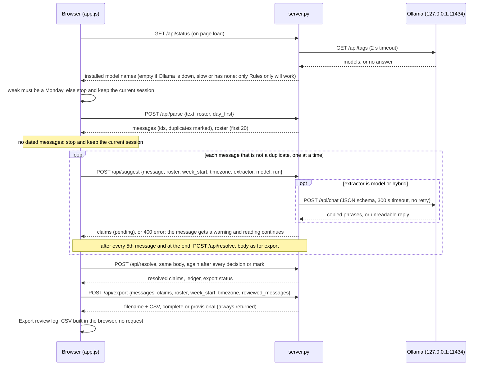
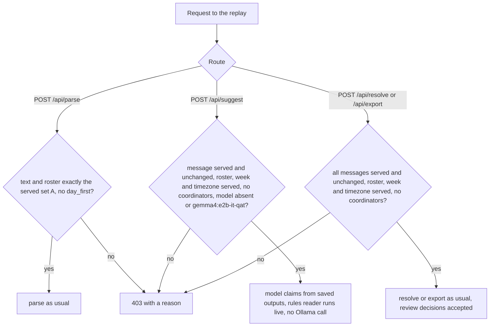

# Interfaces

Everything here was read from `server.py`, `ui/app.js`, `ledger/*.py` and `evaluation/*.py` on 2026-10-20. Status and error examples were produced by calling the running handlers locally with fictional data. Nothing in the "Proposed" section can be called today.

Related: [ARCHITECTURE.md](ARCHITECTURE.md) for data structures and flow; [INTEGRATIONS.md](INTEGRATIONS.md) for the agreed sponsor roles and gates; [COMPETITION.md](COMPETITION.md) for eligibility and historical evidence. This interface document describes the current local application. A planned service or award target does not add a route, dependency or configuration key.

## Contents

- [HTTP server basics](#http-server-basics)
- [Request sequence](#request-sequence) (diagram)
- [GET / and static files](#get--and-static-files)
- [GET /api/status](#get-apistatus)
- [GET /api/demo](#get-apidemo)
- [POST /api/parse](#post-apiparse)
- [POST /api/suggest](#post-apisuggest)
- [POST /api/resolve](#post-apiresolve)
- [POST /api/export](#post-apiexport)
- [Flags](#flags)
- [Message import format](#message-import-format)
- [CSV export](#csv-export) (review log)
- [Final-sheet CSV](#final-sheet-csv)
- [Model-adapter boundary](#model-adapter-boundary)
- [Command-line interface](#command-line-interface)
- [Proposed interfaces (not implemented)](#proposed-interfaces-not-implemented)

## HTTP server basics

- Base URL: `http://127.0.0.1:<port>` (default 8765). The host is fixed to `127.0.0.1`; it is not reachable from other machines.
- **Authentication: none.** Anyone who can open a connection to that port on the same machine can call every route.
- Request bodies are JSON (the `Content-Type` header is not checked; `Content-Length` is used to read the body). An empty body is treated as `{}`.
- Responses: JSON (`application/json`, UTF-8, non-ASCII kept), or the static files. Every response carries `Cache-Control: no-store`. (In [demo mode](#demo-mode-hosted-replay) the host is `0.0.0.0` and the port is `$PORT`.)
- **Errors.** Any exception raised while handling a POST returns **400** with `{"error": "<ExceptionType>: <message>"}`. This includes malformed JSON, missing fields, a `week_start` that is not a Monday, and Ollama being unreachable. There is no 500 response. Unknown POST path: **404** `{"error": "unknown endpoint"}`. Unknown GET path: **404** with the HTML page `ui/404.html` (UI-10).
- No request logging, rate limiting, CORS headers or streaming.
- **Demo mode** (`LEDGER_DEMO=1`, DEP-02): the hosted read-only replay. See [Demo mode](#demo-mode-hosted-replay); refused requests return **403** `{"error": "<reason>"}`.

## Request sequence

One run of **Suggest records** in the local app, as `ui/app.js` performs it. The browser holds all state and sends it again on every recompute; the server keeps nothing between requests.



## Demo mode (hosted replay)

Off unless the environment variable `LEDGER_DEMO` is exactly `1`. Then:

- **Binding:** `0.0.0.0:$PORT` (falls back to the command-line port, then 8765). Without demo mode `PORT` is ignored and the host stays `127.0.0.1`.
- **What it serves:** only fictional set A (`GET /api/demo`, unchanged). The landing page at `/` is the same as locally. The review app at `/app` hides the paste box, roster box, file upload, demo button and day-first option, disables week and timezone, loads set A on arrival and shows the replay banner.
- **`GET /api/status`** returns `{"models": ["gemma4:e2b-it-qat"], "default_model": "gemma4:e2b-it-qat", "demo": true}` without contacting Ollama. This is also Render's health check.
- **`POST /api/parse`** returns 403 unless `text` and `roster` equal the served set A text and roster exactly and `day_first` is not set.
- **`POST /api/suggest`** returns 403 unless:
  - `message` equals one of the served set A messages (all five fields);
  - `roster`, `week_start` and `timezone` equal the served ones;
  - `coordinators` is absent;
  - `model` is absent or `gemma4:e2b-it-qat`.

  For `model` and `hybrid`, Gemma's claims come from `evaluation/runs/gemma4_e2b_it_qat_prompt3/<id>.json`, and `stats` is the saved one plus `"saved": true`. No model is called. The rules reader runs as normal. Claims are identical to a local run whose model call returns the same saved output (unit test).
- **`POST /api/resolve`** and **`POST /api/export`** return 403 unless `messages` is a list of served messages (unchanged), with the served roster, week and timezone and no `coordinators`. Claims, review states and corrections are accepted as usual.
- No other environment variable is read, and nothing is stored or logged.



Observed error responses (fictional calls):

| Call | Status | Body |
|---|---|---|
| `POST /api/suggest` with `{}` | 400 | `{"error": "KeyError: 'message'"}` |
| `POST /api/parse` with body `not json` | 400 | `{"error": "JSONDecodeError: Expecting value: line 1 column 1 (char 0)"}` |
| `POST /api/resolve` with `"week_start": "2026-11-10"` | 400 | `{"error": "ValueError: week_start must be a Monday"}` |
| `POST /api/nope` | 404 | `{"error": "unknown endpoint"}` |
| `GET /nope` | 404 | `ui/404.html` (HTML page linking home, the app and the guide; plain `not found` before UI-10) |

## GET / and static files

- `GET /` → `ui/home.html`, the landing page (UI-09, D-34), locally and in demo mode. Its only request is `GET /api/status`, used to label its buttons ("Open the replay" in demo mode, "Open the app" locally); it loads nothing from another site.
- `GET /docs` → `ui/docs.html`, the user guide with diagrams (UI-10).
- `GET /app` → `ui/index.html`, the review app (served at `/` before UI-09). `GET /index.html` still serves it; `/app/` (trailing slash) returns 404.
- `GET /<name>` → a file inside `ui/` if it exists and ends in `.html`, `.js` or `.css`. Paths that resolve outside `ui/` return 404. A query string is ignored when finding the page: `/?ref=x` serves the landing page (before UI-09 it returned 404).
- Side effects: none.

## GET /api/status

Purpose: tell the page which local models are installed.

Response 200:

```json
{"models": ["gemma4:e2b-it-qat"], "default_model": "gemma4:e2b-it-qat"}
```

- `models` comes from Ollama `GET http://127.0.0.1:11434/api/tags` with a 2 s timeout. If Ollama cannot be reached in time, or answers with no installed models, `models` is `[]` (still 200) and the page shows "Ollama is not reachable: only 'Rules only' will work."
- Side effects: one local request to Ollama.

## GET /api/demo

Purpose: load the fictional set A fixture into the form.

Response 200:

```json
{"text": "# FICTIONAL TEST FIXTURE. Riverside Community Pantry does not exist; ...\n2026-11-02 09:41 | ... ",
 "roster": "# FICTIONAL roster (18 volunteers). One name per line.\nMaria Lopez\n...",
 "week_start": "2026-11-09", "timezone": "America/New_York"}
```

Reads `fixtures/riverside_week.txt`, `fixtures/roster.txt` and `week_start`/`timezone` from `fixtures/reference.json`. Side effects: none.

## POST /api/parse

Purpose: turn pasted text into dated messages and a roster.

Request:

| Field | Type | Required | Meaning |
|---|---|---|---|
| `text` | string | no (default `""`) | messages, see [import format](#message-import-format) |
| `roster` | string | no | one name per line; `#` lines ignored |
| `day_first` | bool | no | WhatsApp dates are DD/MM rather than MM/DD |

Response 200:

```json
{"messages": [
   {"id": "m01", "sent": "2026-11-03 09:00", "sender": "Ana Example", "text": "Tuesday 2-5 works", "duplicate_of": null},
   {"id": "m02", "sent": "2026-11-03 09:30", "sender": "Ana Example", "text": "tuesday 2–5 works", "duplicate_of": "m01"}],
 "roster": ["Ana Example"]}
```

Validation and behaviour:
- Lines that do not start a message are appended to the previous message; text before the first message is dropped; blank lines and lines starting with `#` are skipped.
- Messages are sorted by timestamp (stable for equal times) and numbered `m01`… (more digits when there are 100 or more).
- `duplicate_of` is set when the same sender sent the same text (ignoring case, whitespace, curly quotes and dash style) within 24 hours of the earliest copy.
- The roster is de-duplicated case-insensitively and **silently truncated to 20 names**.
- An input with no recognisable lines returns `"messages": []` (200); the page then shows an error itself.
- Side effects: none.

## POST /api/suggest

Purpose: propose claims for **one** message.

Request:

| Field | Type | Required | Meaning |
|---|---|---|---|
| `message` | object | yes | a message as returned by `/api/parse` |
| `roster` | list of strings | yes | truncated to 20 |
| `week_start` | `YYYY-MM-DD` | yes | must be a Monday |
| `timezone` | string | no | stored only; not used in any calculation |
| `extractor` | `hybrid` \| `model` \| `rules` | no (default `hybrid`) | which reader |
| `model` | string | no | Ollama model name; default `gemma4:e2b-it-qat` |
| `coordinators` | list of strings | no | extra coordinator sender names (only used by `hybrid`; the UI never sends it) |
| `run` | object | no | `{"id": <random token>, "index": <1-based position>, "total": <requests in this run>}`. The page sends it so that opt-in tracing (INT-03) groups one run's requests under one agent span; ignored when tracing is off. Never contains message content |

Response 200 (rules reader, fictional):

```json
{"claims": [{"id": "m01.1", "msg": "m01", "n": 1, "source": "rules", "review": "pending",
  "said": {"person": "SENDER", "day_text": "Tuesday", "time_text": "2-5", "status": "available",
           "condition": "", "replaces_earlier": false, "excerpt": "Tuesday 2-5 works"}}],
 "stats": {}}
```

- With `model` or `hybrid`, `stats` holds `wall_s`, `prompt_tokens`, `output_tokens`, `prompt_s`, `output_s`, `load_s`, `json_ok`. The page ignores `stats`.
- With `hybrid`, claims may carry `hints` (`replace_cue`, `readers_disagree`, `one_reader`, `added_by_rules`); rules-only cancellations are appended as extra claims with `source: "rules"`.
- If `message.duplicate_of` is set the server returns `{"claims": [], "stats": {}, "duplicate_of": "m01"}` **without** calling the model.
- If the model's reply is not valid JSON, the model contributes no claims and `stats.json_ok` is `false` (still 200). With `model` the response has no claims at all. With `hybrid` the rules' cancellations (days the rules read as unavailable) are still added and flagged `added_by_rules`, but no availability is. Since COR-03 (2026-10-20) the page shows a warning on that message in both cases ("…could not be read, so it has no suggestions" / "…Only the rules' cancellations below were added"), keeps reading the next messages, and reports how many messages could not be read fully. A request error for one message (for example Ollama unreachable) is shown on that message the same way instead of stopping the run. No retry is attempted, and a failed message is never offered "Accept all and mark reviewed".
- Errors: Ollama unreachable or a timeout (300 s) → 400 with the exception text. No retries.
- Side effects: one Ollama `/api/chat` call for `model`/`hybrid`; nothing stored.

## POST /api/resolve

Purpose: recompute everything derived from what was said plus the reviewer's decisions. The page calls it every five messages during reading and 250 ms after each edit or click.

Request:

| Field | Type | Required | Meaning |
|---|---|---|---|
| `messages` | list | yes | all messages from `/api/parse` (including `duplicate_of`) |
| `claims` | list | yes | all raw claims, with `review` and optional `override` |
| `roster` | list | yes | truncated to 20 |
| `week_start` | `YYYY-MM-DD` | yes | Monday |
| `timezone` | string | no | stored only |
| `coordinators` | list | no | extra coordinator names |
| `reviewed_messages` | list of strings | no | message ids the reviewer explicitly marked reviewed; see validation below |

`override` fields a reviewer can set: `person`, `dates` (list of ISO dates; days outside the week are discarded), `start`/`end` (`HH:MM`; both empty means "no time"; start must be before end, otherwise the time is unparsed), `status`, `condition`.

Response 200 (fictional: Ana offers Tuesday 2–5 on 3 Nov, then cancels on 5 Nov; "Ana Exampel" is a second, similar roster name):

```json
{"claims": [{"id": "m01.1", "msg": "m01", "source": "rules", "review": "pending", "said": {"…": "…"}, "n": 1,
   "person": "Ana Example", "person_state": "resolved", "person_candidates": [], "similar": ["Ana Exampel"],
   "dates": ["2026-11-10"], "date_state": "resolved", "date_candidates": [], "date_note": "",
   "start": "14:00", "end": "17:00", "time_state": "explicit", "time_note": "",
   "status": "available", "condition": "", "replaces_earlier": false,
   "excerpt_state": "exact", "excerpt_span": [0, 17], "flags": ["similar_name"]}, "…"],
 "ledger": {
   "sheet": {"Ana Example": {}, "Ana Exampel": {}},
   "review_notes": {},
   "history": {"Ana Example|2026-11-10": [
      {"msg": "m01", "sent": "Tue 03 Nov 09:00", "claim": "m01.1", "status": "available", "what": "added", "span": "14:00-17:00"},
      {"msg": "m02", "sent": "Thu 05 Nov 18:00", "claim": "m02.1", "status": "unavailable", "what": "marked unavailable, cancelled", "span": "06:00-23:00"}]},
   "issues": [],
   "counts": {"start": "08:00", "end": "22:00", "step": 30,
              "days": [{"date": "2026-11-09", "available": [0, 0, "…28 values"], "conditional": [0, 0, "…"]}, "…"]}}}
```

- Claims whose `msg` is not among `messages` are ignored.
- `review` becomes `dropped` (with `drop_reason`) only when **both** the quote and the day/time phrases are missing from the message, when the quote names none of the claimed days, or for a coordinator's own self-claim when the coordinator does not resolve to a roster name (a coordinator who is also on the roster is kept). A `rejected` or `accepted` review is never overwritten.
- **Wording check (COR-10, flag only per D-30):** a pending suggestion whose quote is found but whose day or time words are not in the message keeps the `phrase_not_in_message` flag, still counts on the provisional sheet, chart and history, stays excluded from bulk accept, and raises a **non-blocking** issue of kind `check_wording`. The final export takes accepted claims only, so it is absent there until accepted. Example (fictional): message "Happy to help", proposed "Tuesday" / "2-4" → Tuesday 14:00–16:00 on the provisional sheet, flagged and listed; in the final export only once accepted. `issues` may also contain kind `unanswered_change` (COR-07a): `{kind, msg, claim: null, person, date, text}` when a message with a general-English change word names a day on which the sender still has open time but none of that message's live claims touches it; warning only, never applied, and not a blocking kind for the final export. Kind `cue_replacement` (COR-18, D-32): `{kind, msg, claim, person, date, removed: [[start, end, status], ...], text}` when a model or rules claim replaced the person's earlier time for that day only because its message contains a change word (`REPLACE_CUES`), not because the reader marked it as a replacement; the replacement still applies, the issue only asks the reviewer to check it, and it is not a blocking kind.
- `history` entries for duplicate messages have `"what": "repeated"` and an extra `duplicate_of` field.
- `confirmed` summarises the final-sheet export the current state would give: `{"status": "complete"|"provisional", "week", "unreviewed": [ids], "pending": n, "blocking_issues": n, "needs_review_cells": n, "unknown_reviewed": [ids]}`. Rules: [specs/final-export.md](specs/final-export.md).
- Side effects: none.

## POST /api/export

Purpose: produce the confirmed final-sheet CSV. Body: the same as `/api/resolve` (include `reviewed_messages`).

Response 200 (fictional: one accepted Tuesday 10-12 offer, its message marked reviewed):

```json
{"status": "complete", "week": "2026-11-09", "unreviewed": [], "pending": 0, "blocking_issues": 0,
 "needs_review_cells": 0, "unknown_reviewed": [], "rows": 1,
 "filename": "availability-final-2026-11-09-complete.csv",
 "csv": "# availability-final v1; week=2026-11-09; status=complete; unreviewed=; pending=0; blocking_issues=0\nvolunteer,date,start,end,status,condition,cell_state,sources\nAna Example,2026-11-10,10:00,12:00,available,,confirmed,m01.1\n"}
```

- A provisional export is still 200; `status` and `filename` say provisional.
- Ids in `reviewed_messages` that match no message are ignored and returned in `unknown_reviewed`.
- Current validation uses `body.get("reviewed_messages") or []`: omission and JSON values falsy under Python (`null`, `false`, `0`, `""`, `[]`, `{}`) mean no marks. A truthy non-list value or a list containing any non-string returns 400. Clients should always send a list of strings; these tolerated values are implementation behavior, not inferred review.
- Errors: as `/api/resolve` (400 with the exception text).
- Side effects: none; the browser saves `csv` under `filename`.

## Flags

Shown as badges on cards. "Info" flags do not block "Accept all suggestions without warnings".

| Flag | Meaning | Info? |
|---|---|---|
| `who_ambiguous` | name matches several roster entries | |
| `who_unknown` | person not on the roster | |
| `similar_name` | a similar name is on the roster | info |
| `date_ambiguous` | the message does not settle the day | |
| `outside_week` | day is outside the selected week | |
| `date_unreadable` | no day could be read | |
| `time_unreadable` | time could not be read; not applied | |
| `time_unstated` | no time given | info |
| `conditional` | status is conditional | info |
| `excerpt_missing` / `excerpt_approx` | quote not found / only roughly found in the message | |
| `phrase_not_in_message` | day or time words not in the message (exact-word check after normalising case, quotes and dashes); a pending one is listed as a `check_wording` issue (COR-10, D-30) | |
| `days_narrowed_to_quote` / `days_not_in_quote` | quote supports only some / none of the days | |
| `day_modifier_from_quote` | "this/next/last/coming" restored from the quote | |
| `time_from_same_message` | hours copied for "the same" from earlier in the message | info |
| `edited` | the reviewer changed something | info |
| `replace_cue` | hybrid: replacement word, replaces the earlier answer for the day | info |
| `readers_disagree` / `one_reader` | hybrid: model and rules differ / only one found it | |
| `added_by_rules` | hybrid: cancellation only the rules saw | |

## Message import format

Pasted text or an uploaded `.txt`/`.csv` file (read as text in the browser). Three line formats are recognised:

```
2026-11-02 09:41 | Ana Example | I can do Tuesday mornings            # pipe format (YYYY-MM-DD HH:MM or YYYY-MM-DDTHH:MM)
02/11/2026, 09:41 - Ana Example: I can do Tuesday mornings           # WhatsApp Android export
[02/11/2026, 09:41:03] Ana Example: I can do Tuesday mornings        # WhatsApp iOS export
```

- WhatsApp dates are month-first unless **WhatsApp dates are day-first** is ticked; 2-digit years and am/pm are accepted.
- Times are taken as written. They are **not** converted between timezones.
- Roster: one name per line, `#` comments allowed, up to 20 names.

## CSV export

This section describes the **review log**. It is built entirely in the browser by **Export review log (CSV)**; the file is named `availability-log-<week_start>.csv`. For the reconciled result see [Final-sheet CSV](#final-sheet-csv). Every value is quoted and inner quotes are doubled; a value starting with `=`, `+`, `-`, `@`, tab or carriage return is written with a leading apostrophe so spreadsheets do not run it (COR-02).

| Column | Meaning |
|---|---|
| `record_id` | claim id, e.g. `m04.1` (or `m04.u1` for one added by the reviewer) |
| `review` | `accepted`, or `pending` when "include records not yet reviewed" is ticked |
| `volunteer` | roster name, or empty if unresolved |
| `date` | ISO date; one row per date; empty when the date is unresolved |
| `start`, `end` | `HH:MM`, empty when no time |
| `status` | `available`, `conditional` or `unavailable` |
| `condition` | condition text for conditional offers |
| `message_id`, `message_time`, `sender` | source message |
| `excerpt` | the supporting quote as proposed |
| `warnings` | readable text of non-info flags, `; `-separated |

Rejected and dropped suggestions are never exported. **The file is a log of reviewed records in message order, not the final sheet**: an offer and its later cancellation are both rows.

**It cannot reliably reconstruct the final sheet.** There is no `replaces_earlier` column, and `evaluation/score_csv.py` replays every row with `replaces_earlier` set to false. "Tuesday 10-12" followed by "Tuesday 2-4 instead" therefore replays as both ranges, while the app's sheet shows 14:00–16:00 only (checked 2026-10-20 with fictional data). Use the [final-sheet CSV](#final-sheet-csv) for the reconciled result.

After export the status line reports review minutes and counts of accepts, edits, rejects, added records, bulk actions and messages marked reviewed.

Fictional example:

```csv
"record_id","review","volunteer","date","start","end","status","condition","message_id","message_time","sender","excerpt","warnings"
"m01.1","accepted","Ana Example","2026-11-10","14:00","17:00","available","","m01","2026-11-03 09:00","Ana Example","Tuesday 2-5 works",""
"m02.1","accepted","Ana Example","2026-11-10","","","unavailable","","m02","2026-11-05 18:00","Ana Example","Sorry, can't do Tuesday after all",""
```

## Final-sheet CSV

Produced by `POST /api/export` (**Export final sheet (CSV)**) and, for the manual timing condition, typed into `evaluation/final_sheet_template.csv`. The canonical definition is [specs/final-export.md](specs/final-export.md); in short:

```csv
# availability-final v1; week=2026-11-09; status=provisional; unreviewed=m03 m07; pending=2; blocking_issues=1
volunteer,date,start,end,status,condition,cell_state,sources
Ana Example,2026-11-10,14:00,16:00,available,,confirmed,m01.1;m02.1
Ben Example,2026-11-14,,,,,needs_review,
```

| Column | Meaning |
|---|---|
| `volunteer`, `date` | roster name; ISO date inside the week |
| `start`, `end` | `HH:MM` on 15-minute boundaries, 06:00–23:00; empty only on a `needs_review` row with nothing confirmed |
| `status` | `available` or `conditional` (unavailable time has no row) |
| `condition` | condition text for conditional segments |
| `cell_state` | `confirmed`, or `needs_review` when a pending suggestion, a blocking issue or an unreviewed message touches that person/day |
| `sources` | claim ids behind the segment, `;`-separated |

`status=complete` only when every message is marked reviewed, nothing is pending and no `who`/`date`/`time`/`conflict` issue is open. Cells starting with `=`, `+`, `-`, `@`, tab or carriage return are written with a leading apostrophe, which the reader removes (COR-02). The reader (`ledger.export.parse_final_csv`) rejects malformed or self-contradicting files, including `status=complete` with any `needs_review` row or non-zero counts, and any status-line key that appears more than once. It requires the same eight column names exactly once, but permits a different column order. The scorer compares availability/conditional slot states; it does not validate condition prose, source ids or whether a human actually reviewed a message.

## Model-adapter boundary

Internal Python interface, not an HTTP route (`ledger/model.py`):

```python
extract(msg: Message, week: str, model: str = "gemma4:e2b-it-qat",
        num_ctx: int = 4096, timeout: float = 300) -> tuple[list[dict], dict]
available_models() -> list[str]
```

- Returns claim dicts in the `said` shape and a stats dict (including the raw reply under `raw`, which the server removes before responding).
- The current application's only outbound calls are `POST /api/chat` and `GET /api/tags` on `http://127.0.0.1:11434` (hard-coded). With opt-in tracing (`SENTRY_DSN` set and `sentry-sdk` installed), allowlisted spans also go to Sentry, checked by both allowlists; see [ARCHITECTURE §12](ARCHITECTURE.md#12-logging-and-observability). No Backboard or hosted inference request exists.
- Any other reader must return the same `said` shape: `person, day_text, time_text, status, condition, replaces_earlier, excerpt`. `ledger/rules.py` (`extract(msg, roster)`) is the second implementation.
- Changing `SYSTEM` or `EXAMPLES` requires bumping `PROMPT_VERSION`, which changes the cache folder in `evaluation/runs/` (see [TUNING.md](../evaluation/TUNING.md)).

## Command-line interface

All commands run from the project folder. Environment variables: demo mode reads `LEDGER_DEMO` and `PORT`; opt-in tracing reads `SENTRY_DSN`; the browser harness reads `CHROME`.

| Command | Purpose | Notes |
|---|---|---|
| `python3 server.py [port]` | start the app | default 8765; host 127.0.0.1 |
| `LEDGER_DEMO=1 PORT=10000 python3 server.py` | start the read-only replay (DEP-02) | host 0.0.0.0; fictional set A and saved Gemma outputs only; see [Demo mode](#demo-mode-hosted-replay) |
| `python3 -m unittest discover -s tests` | 49 offline checks | no Ollama needed |
| `node tests/browser/session_rerun.mjs` | optional browser check that a failed or rejected rerun keeps the reviewed session and its export | needs Node 22+ and a local Chrome; installs nothing |
| `python3 -m evaluation.run --set A\|B --extractor rules\|model\|hybrid [--model NAME] [--only m02,m05] [--refresh] [--label X]` | score a reader against the fictional reference | model outputs cached per message in `evaluation/runs/<model>_prompt<v>[_setB]/`; a missing model cache also makes a fresh call without --refresh; --refresh forces new calls; writes `evaluation/results/set<S>_<extractor>[_<model>_prompt<v>][_<label>].json`. Since 2026-10-20 unit metrics exclude duplicate messages from both sides and report `duplicate_messages_excluded`/`duplicate_units_excluded` per split (EVAL-10), and the ledger's wrong-conditions count checks every slot of each condition interval (`…partly lost`, EVAL-09) |
| `python3 -m evaluation.compare [frozen]` | print the results table | `frozen` reads `evaluation/results/frozen/` |
| `python3 -m evaluation.score_final FILE.csv --set A\|B [--allow-provisional]` | score a final-sheet CSV (either timing condition) against the reference | exit 2 with the reason for a malformed or self-contradicting file, or for a provisional file without `--allow-provisional`; unresolved cells count as 68 disagreeing slots each; withdrawal and condition metrics are final-state errors (a condition counts once if any slot of its interval is wrong or missing) |
| `python3 -m evaluation.score_csv FILE.csv --set A\|B` | score a review-log CSV against the reference | **does not replay replacements** (`replaces_earlier` is always false); not for the timing study |

Never point `--label` or any script at `evaluation/results/frozen/`; that folder is the first-scored record.

## Proposed interfaces (not implemented)

These **cannot be called today**. They are listed so nobody mistakes them for existing routes.

| Proposal | Purpose | Task |
|---|---|---|
| A `replay` reader for `/api/suggest` that returns saved outputs from `evaluation/runs/` for the fictional fixtures | free hosted demo without a model | [DEP-02](../TASKS.md#deployment-and-submission) |
| Session save/load (download and re-open a JSON file of messages, claims and reviews) | survive reloads | [COR-04](../TASKS.md#core-correctness) |

### Agreed integration boundaries (planned, no new interfaces yet)

- **Local core:** preserve existing parse → suggest → resolve → explicit review → final export contracts. All optional services may be absent and the local workflow must still work. The local app reads no environment variables or `.env` files (demo mode reads `LEDGER_DEMO` and `PORT`; opt-in tracing reads `SENTRY_DSN`); [.env.example](../.env.example) remains comments only.
- **Copilot, GitHub Actions, Entire and optional Backboard R-CLI:** development/process tools, not runtime APIs. Capture genuine work with fictional inputs and inspect public artifacts for private data. No API route or provider-backed memory layer is implied.
- **Sentry:** optional, opt-in structural diagnostics using fictional demonstrations, not message-content telemetry. Implemented 2026-10-21 (INT-03, D-33): `SENTRY_DSN`, optional `sentry-sdk==2.72.0` in `.venv`, two allowlists (`scrub()` in `before_send_transaction`, `clean_envelope()` at the transport) and leak tests; see [ARCHITECTURE §12](ARCHITECTURE.md#12-logging-and-observability).
- **Render and .tech:** proposed judge-facing interactive fictional replay plus a domain pointing at hosting. A replay must be labelled as saved output, keep public input restricted to fictional data and document its actual export/review behavior; do not imply the present loopback-only server is already deployable or that the hosted site runs live Gemma. No replay route is final or implemented. Domain prize eligibility remains conditional on acquisition evidence.
- **ElevenLabs:** narration for the demonstration video, outside the runtime. No voice-input, transcription or in-app speech route is planned for this submission; reconsider product voice only after a validated coordinator need and a separate scope decision.

The exact deployed architecture, credentials, SDKs, transport and configuration belong in a later implementation decision and API update once selected. Do not create placeholder keys or unsupported endpoints to make an integration appear finished. Additional spend remains ₹0; optional integrations require verified free plans or confirmed credits, safe allowance limits and no paid fallback. See [INTEGRATIONS.md](INTEGRATIONS.md).
