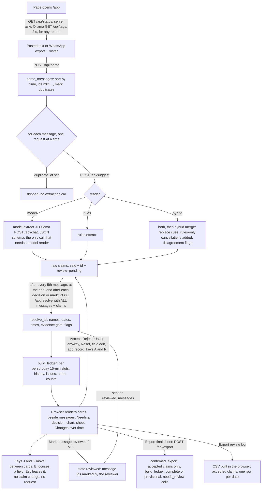
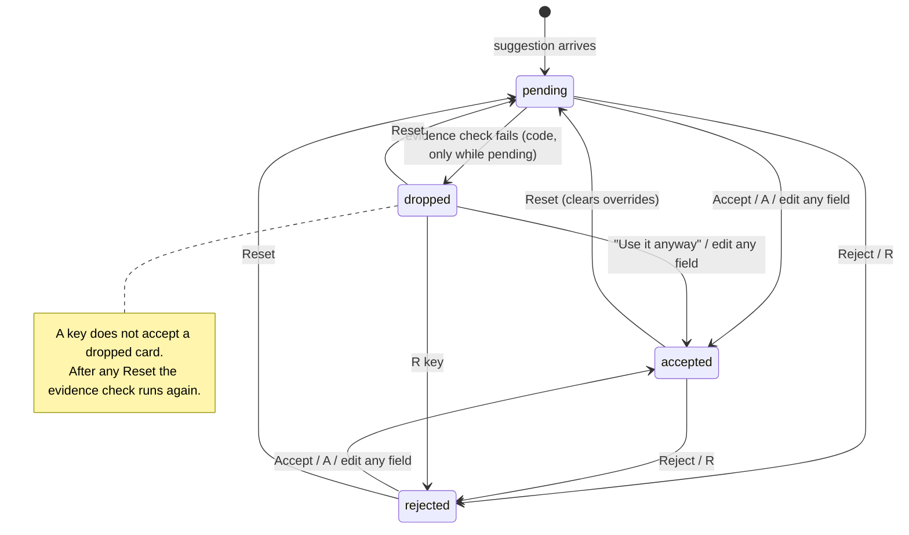
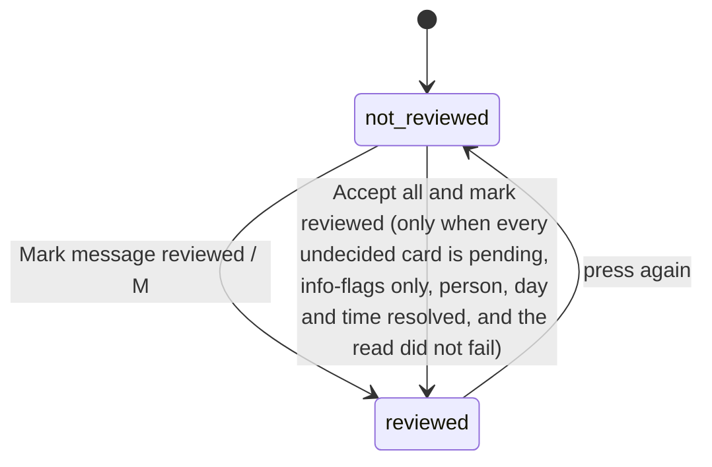
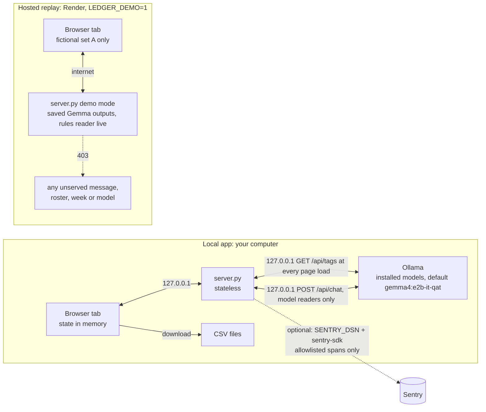

# Architecture

This describes the system **as it exists in the source**, rechecked on 2026-10-23. Dated verification records remain historical evidence; current commands and test results are in [TESTING.md](../TESTING.md). Diagram sources are mapped in [DIAGRAMS.md](DIAGRAMS.md). Status words (Implemented, Verified, Partial, Planned, Unverified, Deferred) mean the same as in [PROGRESS.md](../PROGRESS.md#status-vocabulary).

Related: [API.md](API.md) (interfaces), [DECISIONS.md](DECISIONS.md) (why it is built this way), [PRD.md](PRD.md) (intended behaviour), [INTEGRATIONS.md](INTEGRATIONS.md) (planned supporting services and gates), [COMPETITION.md](COMPETITION.md) (verified competition evidence). Start with [context.md](../context.md) and [CLAUDE.md](../CLAUDE.md).

## 1. System overview

Availazy (formerly Availability Ledger) is a single-user, local web tool. A coordinator pastes dated chat messages and a volunteer roster, picks a week, and gets **suggested availability records**. Each suggestion is shown beside the message it came from, and the coordinator accepts, edits or rejects it. The tool builds a per-person, per-day history, a sheet of who is available when, a half-hourly count chart and two CSV exports: the accepted-only reconciled final sheet and the separate review log.

It records **availability** (when someone says they can or cannot help). It does not assign anyone to a shift. There is no shift, rota or assignment object anywhere in the code.

The central design rule: **the local model copies phrases and proposes status/replacement hints; it computes no dates, times, history or counts.** Ordinary Python resolves and checks those proposals:

| Responsibility | Done by | Where |
|---|---|---|
| Copy who / day words / time words / condition / quote; propose status and replacement hints | Model (Ollama) or keyword rules | `ledger/model.py`, `ledger/rules.py` |
| Cross-check model against rules | Code | `ledger/hybrid.py` |
| Match names to the roster | Code | `ledger/names.py` |
| Turn day and time phrases into dates and times | Code | `ledger/resolve.py` |
| Check the quote and phrases against the message; flag unsupported words; drop claims with neither in the message | Code | `ledger/core.py` (`resolve_claim`) |
| Per-person, per-day history; corrections; cancellations; conditions; conflicts | Code | `ledger/core.py` (`build_ledger`) |
| Counts per half hour | Code | `ledger/core.py` (`build_ledger`) |
| Accept / edit / reject, export | The coordinator, in the browser | `ui/app.js` |

## 2. Repository map

```
server.py              HTTP server (stdlib http.server), local 127.0.0.1 or hosted replay 0.0.0.0, serves ui/ and /api/*
ui/index.html          the review app, served at /app (UI-09)
ui/home.*              landing page at / (home.html, home.css, home.js): system fonts, inline SVG, no external requests
ui/docs.html, docs.css public user guide at /docs; home.css/home.js are shared with it
ui/404.html            styled missing-page response
ui/app.js              all browser state, rendering, review, keyboard shortcuts, CSV export
ui/style.css           styles (light Forest & Parchment palette only, D-35/D-36)
ledger/messages.py     Message type; parse pasted text / WhatsApp exports; roster parsing; duplicate marking
ledger/names.py        roster matching; similar names flagged, never merged
ledger/resolve.py      Calendar; day phrases -> dates; time phrases -> times (no model)
ledger/core.py         claim resolution, evidence gate, ledger/history, counts, evaluation helpers
ledger/export.py       confirmed final sheet (accepted records only), its CSV writer and strict reader
ledger/model.py        Ollama /api/chat call with a JSON schema; prompt v3 (SYSTEM + EXAMPLES)
ledger/rules.py        keyword/regex baseline extractor
ledger/hybrid.py       model + rules merge and cross-check flags
ledger/tracing.py      optional Sentry tracing; no-op unless explicitly enabled with the optional SDK
tests/                 offline unittest suite plus seven optional Node/local-Chrome browser suites; see TESTING.md
evaluation/            scoring scripts, results, cached model outputs, tuning and measurement notes
fixtures/              FICTIONAL message sets A, B and C, rosters, references and set C freeze manifest
requirements-tracing.txt optional sentry-sdk pin; not required for the core app
render.yaml            free-plan fictional replay Blueprint
LICENSE                MIT licence for project code/documentation
```

The application core runs on the Python standard library; the browser code uses no external libraries or CDNs. There is no `package.json`, `pyproject.toml`, core dependency lock file, Dockerfile, database schema or migration system. Optional tracing has its own requirements file. The browser harness uses built-in Node APIs and local Chrome. The public repository and deployed release were checked under REL-02 on 2026-10-23; see [PROGRESS](../PROGRESS.md#rel-02-pushed-release-fresh-clone-ci-and-live-render-verified-2026-10-23) for the exact revision and verification limits rather than treating a branch/HEAD snapshot as an architectural property.

## 3. Runtime and startup

```
python3 server.py [port]        # default port 8765; host is always 127.0.0.1
```

1. `server.py` starts a `ThreadingHTTPServer` on `127.0.0.1:<port>`. The port is the first command-line argument; nothing is read from `.env` files. `SENTRY_DSN` turns on opt-in tracing when the optional `sentry-sdk` is installed (INT-03, §12). The other environment variables are for the hosted read-only replay (DEP-02): with `LEDGER_DEMO=1` it binds `0.0.0.0:$PORT`, serves fictional set A only and answers suggestions from saved Gemma outputs instead of Ollama ([API: demo mode](API.md#demo-mode-hosted-replay)).
2. The browser loads `/app` → `ui/index.html`, `app.js`, `style.css` (sent with `Cache-Control: no-store`). `/` is the landing page (`ui/home.html`, UI-09, D-34), whose buttons open `/app`.
3. `app.js` calls `GET /api/status`, which asks Ollama at the hard-coded `http://127.0.0.1:11434/api/tags` for installed models (2 s timeout). If Ollama is unreachable, too slow or has no models installed, the list is empty and the page says only "Rules only" will work; this check runs on every page load whichever reader is chosen. Otherwise the model menu lists every installed model, with `gemma4:e2b-it-qat` preselected when present.
4. The coordinator loads the fictional demo (`GET /api/demo`) or pastes text, then clicks **Suggest records**.

Ollama is a separate process the user starts (`ollama serve`). The server never starts, installs or downloads anything.

## 4. Frontend / backend relationship

The **review API is stateless**: working review state is retained in the browser tab (`state` in `ui/app.js`) and sent to Python with each request. That state includes parsed messages, raw claims with review status and overrides, the last resolved claims and ledger, the roster, week, reviewed-message marks, confirmed-export summary, current keyboard card and review statistics. The application does not persist this review state to disk, `localStorage` or a database. **Reloading the page loses all review work.** The server does read packaged static files, fictional fixtures and saved replay outputs; it caches the served fixture description in memory. When tracing is enabled it also retains open run-span handles temporarily. These are distinct from review-session persistence.

The browser sends the complete state on every recompute:



## 5. Model integration

Implemented in `ledger/model.py`:

- Endpoint: `POST http://127.0.0.1:11434/api/chat` (hard-coded constant `OLLAMA`).
- Default model `gemma4:e2b-it-qat` (`DEFAULT_MODEL`); the UI lets the user pick any model Ollama lists. The evaluation also used `qwen3.5:4b-q4_K_M`.
- Request options: `temperature 0`, `seed 7`, `num_ctx 4096`, `think: false`, `keep_alive: "30m"`, `stream: false`, and a JSON schema in `format` (claims array with `person, day_text, time_text, status, condition, replaces_earlier, excerpt`).
- Prompt: `SYSTEM` text plus six invented few-shot `EXAMPLES`; `PROMPT_VERSION = 3`. The user turn contains only the planning week, the send time, the sender and the message text. Earlier messages are **not** sent (see [TUNING.md](../evaluation/TUNING.md)).
- Timeout 300 s per call. **No retries.** If the reply is not valid JSON, `extract` returns no claims and `json_ok: false` in its stats. With the model-only reader the message then has no suggestions; with model + rules the rules' cancellations are still added (flagged) but no availability. Since COR-03 the page shows a warning on that message in both cases (`state.failures` in `ui/app.js`).
- The model never sees the roster and never produces dates.

The rules reader (`ledger/rules.py`) emits the same claim shape. It returns nothing for senders who are not on the roster (for example a coordinator).

## 6. Data structures (from source)

### Message (`ledger/messages.py`)

| Field | Type | Notes |
|---|---|---|
| `id` | str | `m01`, `m02`… assigned after sorting by time (stable for equal times) |
| `sent` | datetime | wall-clock time as written; serialised `"YYYY-MM-DD HH:MM"` |
| `sender` | str | as written |
| `text` | str | continuation lines are joined with `\n` |
| `duplicate_of` | str or null | id of the earliest identical message, see §9 |

### Raw claim (what the browser stores)

```json
{"id": "m04.1", "msg": "m04", "n": 1, "source": "model", "review": "pending",
 "said": {"person": "SENDER", "day_text": "Tuesday", "time_text": "after 3", "status": "available",
          "condition": "", "replaces_earlier": false, "excerpt": "Tuesday after 3 works"},
 "override": {"start": "15:00", "end": "18:00"}, "hints": ["one_reader"]}
```

- `source`: `model`, `rules`, `user` (added by the reviewer) or, in hybrid output, `rules` for claims the cross-check added.
- `review`: `pending`, `accepted`, `rejected`. `dropped` is computed by the server (evidence gate) and is never stored by the browser.
- `override`: reviewer edits (`person`, `dates`, `start`, `end`, `status`, `condition`). Overrides win over `said`.
- `hints`: flags added before resolution (hybrid cross-check).

### Resolved claim (returned by `/api/resolve`)

Adds: `person`, `person_state` (`resolved | ambiguous | unknown`), `person_candidates`, `similar`, `dates` (inside the selected week), `date_state` (`resolved | ambiguous | outside_week | unparsed`), `date_candidates`, `date_note`, `start`, `end`, `time_state` (`explicit | period | open | unstated | unparsed`), `time_note`, `status`, `condition`, `replaces_earlier`, `excerpt_state` (`exact | approx | missing | user`), `excerpt_span` (character offsets into the message, used for highlighting), `flags`, and `drop_reason` when dropped. The full flag list is in [API.md](API.md#flags).

### Ledger (returned by `/api/resolve`)

| Key | Meaning |
|---|---|
| `sheet` | `{person: {date: [{status, start, end, claims, review}]}}` — available and conditional segments only |
| `history` | `{"Person|YYYY-MM-DD": [{msg, sent, claim, status, what, span}]}` in message order |
| `issues` | items for "Needs a decision": kinds `who`, `date`, `outside`, `time`, `conflict`, `condition`, `check_wording` (COR-10, non-blocking, D-30), `unanswered_change` (COR-07a, warning only), `cue_replacement` (COR-18, warning only: earlier time removed because of a change word) |
| `review_notes` | `{"Person|date": [text]}` where an unresolved claim might affect that cell |
| `counts` | 08:00–22:00 in 30-minute steps per day: `available` and `conditional` head-counts |

`/api/resolve` also returns `confirmed`, the status of the final-sheet export for the current review marks (see §10).

## 7. Identity, dates, timezones and intervals

- **Identity.** `names.match_person` normalises accents, case and punctuation. "SENDER", "me", "I" mean the sender. A first name shared by several roster entries is **ambiguous** and never guessed. An initial plus surname resolves only when exactly one roster name matches; several matches remain ambiguous (COR-16). A prefix of at least three letters resolves when exactly one roster first name matches ("Sam" with only Samira Haddad on the roster) and is ambiguous when several do ("Sam" with Sam Okafor and Samira Haddad). Names within edit distance 2 of another roster name get a `similar_name` flag ("Maria Lopez" vs "Marta Lopes"). Unknown extracted people produce a "who" issue and are not applied. The roster is capped at 20 names; extras are silently dropped by the server. Browser person controls use this roster; direct API overrides are trusted more broadly, as described in §14 and [API](API.md#post-apiresolve).
- **Coordinator messages.** A sender whose name contains the word "coordinator", or who is in the optional `coordinators` request list, has self-claims dropped **only when the sender does not resolve to a roster name**. A coordinator who is also on the volunteer roster resolves normally, and their claims are kept. The rules reader returns nothing for any sender not on the roster. The UI never sends `coordinators`, so in the app only the name rule applies.
- **Dates.** `resolve.resolve_day` uses the message's send date and the selected week (must start on a Monday). Bare weekdays mean the selected week's day unless sent after that day had passed. "Next Tuesday" resolves only when "the next one to occur" and "the one in next week" agree; otherwise it is ambiguous. "This Saturday" sent before the selected week is `outside_week`. Numeric dates try M/D and D/M and keep the reading inside the week. An agreeing weekday beside an explicit date adds no second date; a contradictory weekday creates ambiguity, and an explicit outside-week date stays outside (COR-13). "one day this weekend", "either", "or" make multiple candidate dates ambiguous.
- **Day words the model drops.** If the model writes "Saturday" but its quote says "this Saturday" (same weekday, a single consistent modifier, quote really in the message), the modifier is restored and the flag `day_modifier_from_quote` is shown (added 2026-10-20).
- **Quote must support days.** A claim whose quote names other days is narrowed to the quoted days, or dropped if none overlap. If the quote names no day at all, this check is skipped.
- **Evidence gate limits.** A claim is dropped only when neither its quote nor its day/time words are in the message. A real quote with invented day or time words is flagged `phrase_not_in_message` but stays pending and is applied to the provisional sheet (COR-10).
- **Times.** `resolve.resolve_time`: ranges ("10:30 to 1", "6-9", "between 2 and 5"), open-ended ("after 3", "from 4", "4 onwards" → to 20:00; "until 12" → from 09:00), periods (morning 09–12, afternoon 13–17, evening 17–20, all day 09–20). Bare hours 1–7 are read as pm. Point times ("at 9") are **not** guessed: unparsed. "the same / same time / same hours" copies the explicit range of the nearest earlier claim in the same message (never another message); otherwise unparsed with "'the same' needs a time earlier in this message".
- **Timezones.** The timezone field is passed to the server and stored in `Calendar.timezone`, but **no code uses it**. Message timestamps are treated as wall-clock times; nothing is converted. Day boundaries (09:00–20:00) and periods are fixed in code and not configurable from the UI or API.
- **Intervals.** Each person/day is an array of 15-minute slots from 06:00 to 23:00. Each slot holds `(status, claim id, message id, specificity)`. An unavailable claim without a time covers the whole 06:00–23:00 day. An available claim without a time covers 09:00–20:00 when no open availability/conditional time exists; otherwise it confirms earlier hours, with the conditional-only settlement rule described in §8.

## 8. Corrections, cancellations and history

`build_ledger` processes non-rejected, non-dropped claims in message order. Within one message, claims covering more resolved dates go first, so "all week" is applied before "except Friday" and the narrower claim wins:

- A later claim overwrites only the slots it covers, so a Monday correction never touches Wednesday (test `test_monday_correction_keeps_wednesday`).
- `replaces_earlier` (from the model, the rules' replacement words or the hybrid "instead/actually/now…" cue) first clears that day's slots from other messages. Separately, a model/rules claim with a stated time and available/conditional status also replaces earlier time when its whole message matches `REPLACE_CUES` (COR-15). That cue-only path raises `cue_replacement` with the removed ranges (COR-18). A cue elsewhere in a multi-part message can therefore cause an unintended replacement; the warning does not undo it. Reviewer-added/reference claims do not use this extra cue rule.
- A later untimed **available** claim converts earlier conditional time to available only when the day has no available time already (COR-14). A mixed available/conditional day is unchanged by that untimed follow-up. This depends on the reader having extracted the correct status.
- Each change is logged per person/day with a reason: `added`, `marked unavailable`, `refined`, `repeated`, `cancelled`, `condition declined`, `condition resolved`, `now available`, `now conditional`, `replaced earlier answer for this day`, `confirmed earlier answer`, `no change`.
- Two claims in the **same** message with equal date specificity that disagree about the same slots create a `conflict` issue; the more cautious reading (unavailable > conditional > available) is kept until a person decides. A narrower exception can supersede a broader same-message claim without that conflict.
- Conditional segments still open at the end create a `condition` issue listing the condition text.
- Ambiguous dates, unknown or ambiguous people, and unreadable times are **not applied**. Each creates an issue. Ambiguous dates and ambiguous people also add `review_notes` to the cells they might affect; unreadable times and outside-week days do not.

## 9. Duplicate messages (added 2026-10-20)

`messages.mark_duplicates` marks a message as `duplicate_of` the earliest copy when the sender and the text match after ignoring case, whitespace, curly quotes and dash style, and it was sent within 24 hours of that earliest copy. Duplicates get no extraction call (browser and `/api/suggest` both skip them), are shown greyed out with "Same as mXX", and the ledger records a `repeated` history entry for each day the original applied. A duplicate does not re-apply slots.

## 10. Review state and export

- New suggestions are `pending`. **Pending suggestions already count on the sheet and chart** (the hint says "From all suggestions you have not rejected"). An earlier experiment that held back flagged pending suggestions was removed (see [DECISIONS.md](DECISIONS.md) D-13).
- Accept / Reject / Reset buttons, "Use it anyway" for dropped suggestions, "+ Add a record", field edits (any edit marks the suggestion accepted), and "Accept all suggestions without warnings" (only suggestions whose flags are all informational).
- Keyboard: J/K move, A accept, R reject, E focus the first field, M toggles the current card's message-review mark, Esc leaves a field. Shortcuts do not fire inside inputs, selects, textareas or editable content.
- **Message review marks.** "Mark message reviewed" (keyboard `M`) records an explicit decision per message in `state.reviewed`; nothing marks a message automatically. "Accept all and mark reviewed" is offered only on an unmarked, non-failed message with at least one undecided suggestion, all of them pending, informational-flags-only, person/day resolved and time not unparsed (unstated is allowed). Duplicates are covered by their original. A successful parsed re-run clears marks; validation/parse failure preserves them.
- Statistics (`accepts`, `edits`, `rejects`, `adds`, `bulk`, `marks`, review timer) are kept in memory and shown on export only.

Card review states and the separate message mark (from `ui/app.js` `review()`, `onFieldChange`, `onClick`, and `ledger/core.py` `resolve_claim`):





Deciding every card never marks a message; a successful re-run clears all marks.
- **Final-sheet export** (`ledger/export.py`, `POST /api/export`): built from **accepted** claims only through the ordinary `build_ledger`, so corrections replay exactly as in the app. It is `complete` only when every non-duplicate message is marked reviewed, nothing is pending and no `who`/`date`/`time`/`conflict` issue is open; otherwise `provisional`. Cells touched by pending claims, blocking issues, or accepted/pending claims of unreviewed messages are `needs_review` (dropped and rejected claims never mark cells); when an unreviewed message's scope is unknown, only the whole-file status shows it. Canonical rules: [specs/final-export.md](specs/final-export.md).
- **Review-log export** is generated in the browser: one row per accepted suggestion per date (plus pending ones if "include records not yet reviewed" is ticked); rejected and dropped are excluded. It is a **record log, not the final sheet**: a cancelled offer and its cancellation both appear, in message order. The file cannot reliably reconstruct the sheet: it has no `replaces_earlier` column, and `evaluation/score_csv.py` replays every row as not replacing anything. Column details and an example: [API.md](API.md#csv-export).

## 11. Errors, retries, interruption

- Every exception inside a POST handler becomes HTTP **400** with `{"error": "<ExceptionType>: <message>"}`; there is no 500 path. Unknown POST paths: 404 JSON. Unknown GET paths: 404 with the styled page `ui/404.html` (UI-10). In demo mode a refused request returns 403 (`Forbidden`).
- The browser processes messages one request at a time. Since COR-03 (2026-10-20), a request error or an unreadable model reply marks only that message with a warning and reading continues; the status line reports "N of M messages could not be read fully", and failed messages are never offered combined accept-and-review. A successful re-run starts a fresh session; a validation/parse failure before that preserves the old session, as described below. Failed requests are not retried; there is no cancel button or resume.
- Model calls time out after 300 s. If Ollama is down, `/api/suggest` with the model or hybrid reader fails with a 400 (`URLError…`).
- A failed request (including a lost connection to the local server) does **not** erase browser state: claims and decisions already held are kept. Reloading the page clears it; a re-run replaces it only after valid settings and a usable parse have been committed.
- **Re-running Suggest records** reads the proposed week and timezone into local variables, validates the week and parses the input first. Only when the input parses into at least one dated message does it commit the new week, timezone, messages and roster together with an empty review state. A non-Monday week, a parse error or an input with no dated messages leaves the previous session (claims, decisions, marks, settings) unchanged, so an export can never combine old approvals with new settings. A failure later, while reading messages, keeps the new session with the claims read so far.

## 12. Logging and observability

- The server suppresses normal HTTP request logging (`log_message` is a no-op). It prints a startup address and, if enabled, a tracing notice. This does not control Python/runtime error output, Ollama logs or hosting-platform logs.
- **Opt-in tracing (INT-03, D-33).** By default nothing is sent anywhere except to Ollama on `127.0.0.1`. With `SENTRY_DSN` set and the optional `sentry-sdk` installed (`requirements-tracing.txt`, into `.venv`), `ledger/tracing.py` sends structural spans to Sentry. Without either, every tracing call is a no-op and `sentry_sdk` is never imported. Demo mode never initialises it.
  - **Spans at the call sites,** not in `ledger/model.py`:
    - `server.py` opens one `gen_ai.invoke_agent` span per browser suggest run. The page sends a random run token, the request's position and the request count; `tracing.Runs` keeps the span open across those requests.
    - Inside the run: one `gen_ai.chat` span per model call (model, Ollama's load/prompt/output times, token counts, JSON-ok, claim count, message position, `error.type` on failure), and `ledger.hybrid_merge`.
    - Resolve, confirmed export, ledger build and final CSV spans join the open run, or form a small `ledger request` transaction.
    - `evaluation/run.py` wraps a run the same way, with a chat span per fresh model call and `ledger.score` / `ledger.build_ledger` stages.
  - **Two allowlists before transmission:**
    1. `transaction_hook` (the SDK's `before_send_transaction`) runs `scrub()`. It rebuilds each transaction from listed fields, span-data keys and value shapes (identifier-like strings only, our own span names).
    2. `clean_envelope()`, in a `CleaningTransport` wrapped around the SDK's transport at init, is the last step before sending:
       - it runs `scrub()` on transaction items again;
       - it rebuilds every streamed v2 span item with the same `_value`/`NAME` rules;
       - it drops spans it can't clean, and every other item type.

    The second layer matters because sentry-sdk 2.72 sends `gen_ai.*` spans (our `chat` spans) as separate streamed items (`stream_gen_ai_spans`, default on, kept for Sentry's Agents view). In 2.72 they are split out after `before_send_transaction`, so layer 1 also covers them today. Layer 2 makes that independent of SDK ordering.
  - **Structural attributes kept on streamed spans**, with fixed value checks:
    - `sentry.op`, `sentry.origin`;
    - `sentry.release` (ours only), `sentry.environment` (`local` only);
    - `sentry.segment.name` (our names only), `sentry.segment.id` (16 hex);
    - `sentry.sdk.name`, `sentry.sdk.version`;
    - `process.runtime.name`, `process.runtime.version`.

    Span fields kept: `trace_id`, `span_id`, `parent_span_id`, `name`, `status`, `is_segment`, `start_timestamp`, `end_timestamp`. Dropped, for example: `server.address`, `user.*`, `thread.*`, and any other key.
  - **Not used:** `before_send_span`. In 2.72 it runs only with `trace_lifecycle="stream"`, and never on the streamed `gen_ai` items. The lifecycle is pinned to `"static"`.
  - **SDK settings:** error events and breadcrumbs are dropped. Default and auto-enabled integrations are off (no logging, HTTP-client, argv or module capture). `send_default_pii=False` and `data_collection` are all off; no local variables or source context; no sessions, client reports or logs.
  - **Test:** `tests/test_tracing.py` sends invented sensitive strings through these paths into a capturing transport and finds none of them.
- **Received-data boundary (owner evidence, 2026-10-21/22):** these allowlists describe what the application sends. Received traces showed `user.geo` values not sent by this code; their origin remains unverified. After owner project IP/sensitive-field settings, a new fictional chat span and its parent showed four geo values `[Filtered]`; chat Input/Output tabs displayed no content. This is targeted received-data evidence, not a full payload or enrichment-origin audit, key removal or retroactive scrubbing. See [Sentry handoff](SENTRY_HANDOFF.md) for exact settings, source references and uninspected surfaces.
- Model timing and token counts are returned by `/api/suggest` in `stats` but the UI does not display them. The evaluation scripts record them per message in `evaluation/runs/` and summarise them in result JSON.
- `evaluation/run.py` samples memory with macOS tools (`ps`, `sysctl`, `memory_pressure`, `vm_stat`) and Ollama `/api/ps` while it runs. These are local reads only.

## 13. Data boundaries

| Data | Where it lives | Leaves the machine? |
|---|---|---|
| Pasted messages, roster, claims, review decisions | Retained in browser memory; sent to the local Python server on 127.0.0.1 with each request and processed transiently; no application persistence | No |
| Model prompts and replies | Sent to Ollama on 127.0.0.1 | No |
| Exported CSV | Downloaded by the browser to wherever the user saves it | Only if the user shares it |
| Evaluation caches and results | `evaluation/runs/`, `evaluation/results/` (fictional fixtures only); committed evidence is also in the public repository and replay deployment | Public fictional evidence is shared through Git/hosting; local evaluation does not itself upload it |
| Tracing spans (opt-in, INT-03) | Built in process from allowlisted timing, count, model and stage fields, checked by both allowlists (`scrub()` and `clean_envelope()`) | Only when the user sets `SENTRY_DSN` (to Sentry); never in demo mode |



The dashed arrow to Sentry exists only on the local server; demo mode enters its serving loop before tracing is initialised. Received location attributes and their still-unverified origin are outside the application allowlist guarantee ([Sentry handoff](SENTRY_HANDOFF.md)).

Runtime integrations today: the local Gemma model, the opt-in Sentry tracing above, and the hosted replay (fictional data, no model calls). Any future runtime service must follow [DECISIONS.md](DECISIONS.md) D-17 and the detailed [integration contracts](INTEGRATIONS.md): opt-in/off by default, verified free allowance, no private content in telemetry, disclosure of external transfers, and no disruption to the local workflow. Development tools and demo narration are separate data paths, not application runtime dependencies.

## 14. Known technical limitations

- No persistence or session save/load; one browser tab is the only copy of review work.
- The review-log export cannot be replayed into the sheet (use the final-sheet export instead). Both CSV writers prefix formula-like cells (starting with `=`, `+`, `-`, `@`, tab or carriage return) with an apostrophe (COR-02).
- Evidence gate: a real quote with invented day or time words is applied provisionally (flagged, pending).
- Pending suggestions count on the sheet and chart, so the sheet is provisional until everything is reviewed.
- Timezone is not used; day start/end and period hours are fixed.
- A failed or unreadable model reply is not retried; the message gets a warning (COR-03) and has no suggestions (model only) or only rules-added cancellations (model + rules).
- Single-message extraction: context from earlier messages is never given to the model; "still on for Saturday" relies on the ledger's confirmation rule.
- Roster capped at 20; automatic name matching leaves unknown people unresolved. Direct reviewer overrides are trusted and can supply a name outside the roster; see the API validation limits below.
- Point times ("at 9") are not read; recurring phrases ("every other Tuesday") are not supported.
- Rules negation takes precedence over condition words: "Saturday 9-12 if it isn't raining" is read as unavailable, not conditional (COR-19, proposed fix). A firm follow-up misread by a reader can also incorrectly settle a condition. These are known limitations, not promises of complete language understanding.
- No authentication, request-size limit, rate limiting or explicit Origin/CSRF check. The local server is intended for one trusted user's loopback workflow; the hosted endpoint is a fictional replay, not a general service for private messages.
- The JSON API is not a fully schema-validated trust boundary. Reviewer overrides are trusted: direct API callers can supply a person outside the roster or malformed date/time values beyond what browser controls offer. The ledger rounds/clips intervals into its 15-minute 06:00–23:00 grid; the final CSV reader separately enforces strict roster/date/interval rules. Use the documented request shapes, not arbitrary client data.
- Historical (2026-10-20): the availability sheet table overflowed its panel in a 1400 px headless screenshot. UI-01 later changed the sheet layout; this note is kept as history and was not re-measured in DOC-09.
- Accessibility: the recorded UI-02 automated Chrome pass covered labels, focus, light-theme contrast and narrow layouts. VoiceOver/screen readers, Firefox and Safari remain unverified; repeated card-button names and possible repeated failed-read announcements are proposed UI-22 follow-ups. See [TASKS](../TASKS.md).
- Unit tests run on macOS with Python 3.15 and 3.12 and in CI on Ubuntu with 3.12; the README's "Python 3.10+" is a stated requirement that has not been tested on 3.10 or 3.11.

## 15. Deployment

### Local app (Implemented)

`python3 server.py` on the coordinator's own computer, with Ollama on the same machine for the model readers. "Rules only" works without Ollama.

### Hosted replay (Implemented, deployed 2026-10-21, DEP-02)

`https://availability-ledger-replay.onrender.com`, from [render.yaml](../render.yaml) on Render's free plan. With `LEDGER_DEMO=1` the server binds `0.0.0.0:$PORT`, serves only fictional set A, answers model readers from saved Gemma outputs in `evaluation/runs/gemma4_e2b_it_qat_prompt3/` (the rules reader runs live), never calls Ollama, never initialises tracing, and refuses with 403 any message, roster, week, timezone or model it did not serve ([API: demo mode](API.md#demo-mode-hosted-replay)). No hosted Gemma runtime exists.

*Earlier text here (2026-10-20) described the replay as planned and not built; superseded by the deployment above.*

The landing page is at `/`, the interactive replay at `/app`, and the guide at `/docs`. REL-02 records the 2026-10-23 deployed-front-end match and live behavior; it does not claim direct inspection of Render's server source/dashboard. The owner's existing `bipulchamoli.tech` is a separate deferred DNS/eligibility proposal, not a verified project address. A domain is an address, not hosting. Keep the replay fictional and avoid paid upgrades; current account/allowance decisions belong to the owner. See [README deployment instructions](../README.md#hosted-replay-render), [INTEGRATIONS.md](INTEGRATIONS.md) and DEP-02 in [TASKS.md](../TASKS.md).

## 16. Supporting technology roles and status

The core runtime stays browser → local Python → local Ollama. Supporting technologies have separate purposes and data boundaries; they must not be added as unnecessary dependencies on every coordinator request.

| Path | Intended role and boundary | Gate before use |
|---|---|---|
| Development: GitHub Actions; Copilot use unverified | Implemented CI: unit, protected-evidence integrity and cache-only re-score jobs on push/PR to main. This is separate from Copilot coding-agent authorship, for which no evidence is recorded. | Latest dated remote verification is REL-02; see TESTING for local equivalents. |
| Development: Entire | Capture actual future sessions, decisions and commit checkpoints. No application API or runtime dependency is implied. | Confirm supported agent compatibility and inspect/redact sessions before sharing; never fabricate past use or checkpoints. Transcripts reconstructed from genuinely captured records must retain authentic provenance. |
| Development: Backboard R-CLI | Optional bounded task using an existing local model if compatible and useful. | Verify model compatibility, local routing, external data handling and free allowance. Do not switch application inference to a cloud provider or upload private data to obtain eligibility. |
| Optional runtime diagnostics: Sentry | Allow-listed operational metadata about extraction failure/latency and a documented real debugging/performance finding. No private text, names, quotes, prompts, replies or sensitive raw exceptions. | Explicit dependency/network/privacy architecture decision before code; verify Python/runtime support, default capture behavior, redaction with fictional data, opt-in/off-by-default operation and free quota. **Implemented 2026-10-21 (INT-03, D-33):** `SENTRY_DSN` plus optional `sentry-sdk` 2.72.0; see §12. Real failed/successful traces and a timeout finding are now verified by owner evidence; bounded privacy verification and explicit open checks are in [SENTRY_HANDOFF](SENTRY_HANDOFF.md). |
| Public demo: Render; domain deferred | Implemented and deployed fixed fictional saved-output replay with review/export interactions, clearly disclosed. Domain supplies DNS only and is not verified as connected. | Preserve the served-data checks and saved-output disclosure; account/free-plan decisions remain with the owner, domain acquisition/renewal evidence remains separate. |
| Public video: ElevenLabs | **Dropped** by the owner on 2026-10-22 ([D-37](DECISIONS.md)); not used. The demo is narrated live or captioned. | — |

Detailed acceptance/evidence gates are canonical in [INTEGRATIONS.md](INTEGRATIONS.md). Competition eligibility and strategic priority are canonical in [COMPETITION.md](COMPETITION.md). Planned/deferred rows are not completed integrations; no status grants permission for further installation, credit claims, deployment or publication.

**Evidence chronology:** set C was frozen before the safeguards and first-scored once on 2026-10-21; its frozen results are the independent headline. COR-13–COR-18 changes and all current A/B/C re-scores are post-hoc. Coordinator validation and a matched timing study remain unfinished. Necessary development can create genuine sponsor evidence along the way, but no service or sponsor proof substitutes for a reviewed final artifact or independent validation.
