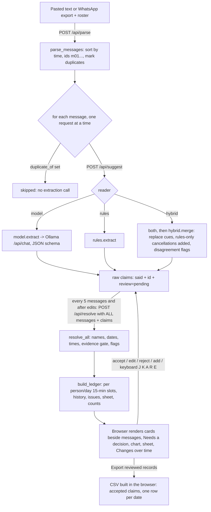

# Architecture

This describes the system **as it exists in the source on 2026-10-20**. Proposed changes are in clearly marked sections at the end. Status words (Implemented, Verified, Partial, Planned, Unverified, Deferred) mean the same as in [PROGRESS.md](../PROGRESS.md#status-vocabulary).

Related: [API.md](API.md) (interfaces), [DECISIONS.md](DECISIONS.md) (why it is built this way), [PRD.md](PRD.md) (intended behaviour).

## 1. System overview

Availability Ledger is a single-user, local web tool. A coordinator pastes dated chat messages and a volunteer roster, picks a week, and gets **suggested availability records**. Each suggestion is shown beside the message it came from, and the coordinator accepts, edits or rejects it. The tool builds a per-person, per-day history, a sheet of who is available when, a half-hourly count chart and a CSV export.

It records **availability** (when someone says they can or cannot help). It does not assign anyone to a shift. There is no shift, rota or assignment object anywhere in the code.

The central design rule: **a local open model only copies phrases out of each message.** Ordinary Python decides everything else:

| Responsibility | Done by | Where |
|---|---|---|
| Copy who / which day words / which time words / status / condition / quote | Model (Ollama) or keyword rules | `ledger/model.py`, `ledger/rules.py` |
| Cross-check model against rules | Code | `ledger/hybrid.py` |
| Match names to the roster | Code | `ledger/names.py` |
| Turn day and time phrases into dates and times | Code | `ledger/resolve.py` |
| Check the quote and phrases against the message; flag unsupported words; drop claims with neither in the message | Code | `ledger/core.py` (`resolve_claim`) |
| Per-person, per-day history; corrections; cancellations; conditions; conflicts | Code | `ledger/core.py` (`build_ledger`) |
| Counts per half hour | Code | `ledger/core.py` (`build_ledger`) |
| Accept / edit / reject, export | The coordinator, in the browser | `ui/app.js` |

## 2. Repository map

```
server.py              HTTP server (stdlib http.server), binds 127.0.0.1, serves ui/ and /api/*
ui/index.html          single page
ui/app.js              all browser state, rendering, review, keyboard shortcuts, CSV export
ui/style.css           styles (light and dark via prefers-color-scheme)
ledger/messages.py     Message type; parse pasted text / WhatsApp exports; roster parsing; duplicate marking
ledger/names.py        roster matching; similar names flagged, never merged
ledger/resolve.py      Calendar; day phrases -> dates; time phrases -> times (no model)
ledger/core.py         claim resolution, evidence gate, ledger/history, counts, evaluation helpers
ledger/model.py        Ollama /api/chat call with a JSON schema; prompt v3 (SYSTEM + EXAMPLES)
ledger/rules.py        keyword/regex baseline extractor
ledger/hybrid.py       model + rules merge and cross-check flags
tests/test_ledger.py   21 unittest checks (stdlib only)
evaluation/            scoring scripts, results, cached model outputs, tuning and measurement notes
fixtures/              FICTIONAL message sets A and B, rosters, hand-written references, manual-entry CSV template
```

There is no package manifest, lock file, Dockerfile, deployment configuration, `.git` directory or licence file in the project folder. Everything runs on the Python standard library; the browser code uses no external libraries or CDNs.

## 3. Runtime and startup

```
python3 server.py [port]        # default port 8765; host is always 127.0.0.1
```

1. `server.py` starts a `ThreadingHTTPServer` on `127.0.0.1:<port>`. The port is the first command-line argument; nothing is read from environment variables or `.env` files.
2. The browser loads `/` → `ui/index.html`, `app.js`, `style.css` (sent with `Cache-Control: no-store`).
3. `app.js` calls `GET /api/status`, which asks Ollama at the hard-coded `http://127.0.0.1:11434/api/tags` for installed models (2 s timeout). If Ollama is unreachable the page says only "Rules only" will work.
4. The coordinator loads the fictional demo (`GET /api/demo`) or pastes text, then clicks **Suggest records**.

Ollama is a separate process the user starts (`ollama serve`). The server never starts, installs or downloads anything.

## 4. Frontend / backend relationship

The **server is stateless**. All working state is retained in the browser tab (`state` in `ui/app.js`) and sent to the local Python server with each request, which processes it transiently and keeps nothing. That state is: parsed messages, raw claims with review status and overrides, the last resolved claims and ledger, the roster, the week, the current keyboard card and review statistics. Nothing is written to disk, `localStorage` or a database. **Reloading the page loses all review work.**

The browser sends the complete state on every recompute:



## 5. Model integration

Implemented in `ledger/model.py`:

- Endpoint: `POST http://127.0.0.1:11434/api/chat` (hard-coded constant `OLLAMA`).
- Default model `gemma4:e2b-it-qat` (`DEFAULT_MODEL`); the UI lets the user pick any model Ollama lists. The evaluation also used `qwen3.5:4b-q4_K_M`.
- Request options: `temperature 0`, `seed 7`, `num_ctx 4096`, `think: false`, `keep_alive: "30m"`, `stream: false`, and a JSON schema in `format` (claims array with `person, day_text, time_text, status, condition, replaces_earlier, excerpt`).
- Prompt: `SYSTEM` text plus six invented few-shot `EXAMPLES`; `PROMPT_VERSION = 3`. The user turn contains only the planning week, the send time, the sender and the message text. Earlier messages are **not** sent (see [TUNING.md](../evaluation/TUNING.md)).
- Timeout 300 s per call. **No retries.** If the reply is not valid JSON, `extract` returns no claims and `json_ok: false` in its stats. With the model-only reader the message then has no suggestions; with model + rules the rules' cancellations are still added (flagged) but no availability. Either way the page shows no failure warning (see [TASKS.md](../TASKS.md) COR-03).
- The model never sees the roster and never produces dates.

The rules reader (`ledger/rules.py`) emits the same claim shape. It returns nothing for senders who are not on the roster (for example a coordinator).

## 6. Data structures (from source)

### Message (`ledger/messages.py`)

| Field | Type | Notes |
|---|---|---|
| `id` | str | `m01`, `m02`… assigned after sorting by time (stable for equal times) |
| `sent` | datetime | wall-clock time as written; serialised `"YYYY-MM-DD HH:MM"` |
| `sender` | str | as written |
| `text` | str | continuation lines are joined with `\n` |
| `duplicate_of` | str or null | id of the earliest identical message, see §9 |

### Raw claim (what the browser stores)

```json
{"id": "m04.1", "msg": "m04", "n": 1, "source": "model", "review": "pending",
 "said": {"person": "SENDER", "day_text": "Tuesday", "time_text": "after 3", "status": "available",
          "condition": "", "replaces_earlier": false, "excerpt": "Tuesday after 3 works"},
 "override": {"start": "15:00", "end": "18:00"}, "hints": ["one_reader"]}
```

- `source`: `model`, `rules`, `user` (added by the reviewer) or, in hybrid output, `rules` for claims the cross-check added.
- `review`: `pending`, `accepted`, `rejected`. `dropped` is computed by the server (evidence gate) and is never stored by the browser.
- `override`: reviewer edits (`person`, `dates`, `start`, `end`, `status`, `condition`). Overrides win over `said`.
- `hints`: flags added before resolution (hybrid cross-check).

### Resolved claim (returned by `/api/resolve`)

Adds: `person`, `person_state` (`resolved | ambiguous | unknown`), `person_candidates`, `similar`, `dates` (inside the selected week), `date_state` (`resolved | ambiguous | outside_week | unparsed`), `date_candidates`, `date_note`, `start`, `end`, `time_state` (`explicit | period | open | unstated | unparsed`), `time_note`, `status`, `condition`, `replaces_earlier`, `excerpt_state` (`exact | approx | missing | user`), `excerpt_span` (character offsets into the message, used for highlighting), `flags`, and `drop_reason` when dropped. The full flag list is in [API.md](API.md#flags).

### Ledger (returned by `/api/resolve`)

| Key | Meaning |
|---|---|
| `sheet` | `{person: {date: [{status, start, end, claims, review}]}}` — available and conditional segments only |
| `history` | `{"Person|YYYY-MM-DD": [{msg, sent, claim, status, what, span}]}` in message order |
| `issues` | items for "Needs a decision": kinds `who`, `date`, `outside`, `time`, `conflict`, `condition` |
| `review_notes` | `{"Person|date": [text]}` where an unresolved claim might affect that cell |
| `counts` | 08:00–22:00 in 30-minute steps per day: `available` and `conditional` head-counts |

## 7. Identity, dates, timezones and intervals

- **Identity.** `names.match_person` normalises accents, case and punctuation. "SENDER", "me", "I" mean the sender. A first name shared by several roster entries is **ambiguous** and never guessed. A prefix of at least three letters resolves when exactly one roster first name matches ("Sam" with only Samira Haddad on the roster) and is ambiguous when several do ("Sam" with Sam Okafor and Samira Haddad). Names within edit distance 2 of another roster name get a `similar_name` flag ("Maria Lopez" vs "Marta Lopes"). Unknown people produce a "who" issue and are not applied. The roster is capped at 20 names; extras are silently dropped by the server.
- **Coordinator messages.** A sender whose name contains the word "coordinator", or who is in the optional `coordinators` request list, has self-claims dropped **only when the sender does not resolve to a roster name**. A coordinator who is also on the volunteer roster resolves normally, and their claims are kept. The rules reader returns nothing for any sender not on the roster. The UI never sends `coordinators`, so in the app only the name rule applies.
- **Dates.** `resolve.resolve_day` uses the message's send date and the selected week (must start on a Monday). Bare weekdays mean the selected week's day unless sent after that day had passed during the week. "Next Tuesday" resolves only when "the next one to occur" and "the one in next week" agree; otherwise it is ambiguous. "This Saturday" sent before the selected week is `outside_week`. Numeric dates try M/D and D/M and keep the reading inside the week. "one day this weekend", "either", "or" make the result ambiguous.
- **Day words the model drops.** If the model writes "Saturday" but its quote says "this Saturday" (same weekday, a single consistent modifier, quote really in the message), the modifier is restored and the flag `day_modifier_from_quote` is shown (added 2026-10-20).
- **Quote must support days.** A claim whose quote names other days is narrowed to the quoted days, or dropped if none overlap. If the quote names no day at all, this check is skipped.
- **Evidence gate limits.** A claim is dropped only when neither its quote nor its day/time words are in the message. A real quote with invented day or time words is flagged `phrase_not_in_message` but stays pending and is applied to the provisional sheet (COR-10).
- **Times.** `resolve.resolve_time`: ranges ("10:30 to 1", "6-9", "between 2 and 5"), open-ended ("after 3", "from 4", "4 onwards" → to 20:00; "until 12" → from 09:00), periods (morning 09–12, afternoon 13–17, evening 17–20, all day 09–20). Bare hours 1–7 are read as pm. Point times ("at 9") are **not** guessed: unparsed. "the same / same time / same hours" copies the explicit range of the nearest earlier claim in the same message (never another message); otherwise unparsed with "'the same' needs a time earlier in this message".
- **Timezones.** The timezone field is passed to the server and stored in `Calendar.timezone`, but **no code uses it**. Message timestamps are treated as wall-clock times; nothing is converted. Day boundaries (09:00–20:00) and periods are fixed in code and not configurable from the UI or API.
- **Intervals.** Each person/day is an array of 15-minute slots from 06:00 to 23:00. Each slot holds `(status, claim id, message id, specificity)`. An unavailable claim without a time covers the whole 06:00–23:00 day. An available claim without a time covers 09:00–20:00 if there is no earlier answer for that day, and otherwise counts as a confirmation that changes nothing.

## 8. Corrections, cancellations and history

`build_ledger` processes non-rejected, non-dropped claims in message order. Within one message, claims covering more resolved dates go first, so "all week" is applied before "except Friday" and the narrower claim wins:

- A later claim overwrites only the slots it covers, so a Monday correction never touches Wednesday (test `test_monday_correction_keeps_wednesday`).
- `replaces_earlier` (from the model, the rules' replacement words or the hybrid "instead/actually/now…" cue) first clears that day's slots from other messages.
- Each change is logged per person/day with a reason: `added`, `marked unavailable`, `refined`, `repeated`, `cancelled`, `condition declined`, `condition resolved`, `now available`, `now conditional`, `replaced earlier answer for this day`, `confirmed earlier answer`, `no change`.
- Two claims in the **same** message that disagree about the same slots create a `conflict` issue; the more cautious reading (unavailable > conditional > available) is kept until a person decides.
- Conditional segments still open at the end create a `condition` issue listing the condition text.
- Ambiguous dates, unknown or ambiguous people, and unreadable times are **not applied**. Each creates an issue. Ambiguous dates and ambiguous people also add `review_notes` to the cells they might affect; unreadable times and outside-week days do not.

## 9. Duplicate messages (added 2026-10-20)

`messages.mark_duplicates` marks a message as `duplicate_of` the earliest copy when the sender and the text match after ignoring case, whitespace, curly quotes and dash style, and it was sent within 24 hours of that earliest copy. Duplicates get no extraction call (browser and `/api/suggest` both skip them), are shown greyed out with "Same as mXX", and the ledger records a `repeated` history entry for each day the original applied. A duplicate does not re-apply slots.

## 10. Review state and export

- New suggestions are `pending`. **Pending suggestions already count on the sheet and chart** (the hint says "From all suggestions you have not rejected"). An earlier experiment that held back flagged pending suggestions was removed (see [DECISIONS.md](DECISIONS.md) D-13).
- Accept / Reject / Reset buttons, "Use it anyway" for dropped suggestions, "+ Add a record", field edits (any edit marks the suggestion accepted), and "Accept all suggestions without warnings" (only suggestions whose flags are all informational).
- Keyboard: J/K move, A accept, R reject, E focus the first field, Esc leave a field. Shortcuts do not fire inside inputs, selects or textareas.
- Statistics (`accepts`, `edits`, `rejects`, `adds`, `bulk`, review timer) are kept in memory and shown on export only.
- **Export** is generated in the browser: one row per accepted suggestion per date (plus pending ones if "include records not yet reviewed" is ticked); rejected and dropped are excluded. It is a **record log, not the final sheet**: a cancelled offer and its cancellation both appear, in message order. The file cannot reliably reconstruct the sheet: it has no `replaces_earlier` column, and `evaluation/score_csv.py` replays every row as not replacing anything. Column details and an example: [API.md](API.md#csv-export).

## 11. Errors, retries, interruption

- Every exception inside a POST handler becomes HTTP **400** with `{"error": "<ExceptionType>: <message>"}`; there is no 500 path. Unknown POST paths: 404 JSON. Unknown GET paths: 404 `text/plain` "not found".
- The browser processes messages one request at a time. On the first error it stops, shows "Error: …" in the status line, and keeps the claims received so far. Clicking **Suggest records** again restarts from scratch (clears claims). There is no retry, cancel button or resume.
- Model calls time out after 300 s. If Ollama is down, `/api/suggest` with the model or hybrid reader fails with a 400 (`URLError…`).
- A failed request (including a lost connection to the local server) does **not** erase browser state: claims and decisions already held are kept. Reloading the page, or clicking **Suggest records** again, clears it.

## 12. Logging and observability

- The server suppresses request logging (`log_message` is a no-op) and prints only its start-up line.
- No telemetry, analytics, crash reporting or tracing is implemented. Nothing is sent anywhere except to Ollama on `127.0.0.1`.
- Model timing and token counts are returned by `/api/suggest` in `stats` but the UI does not display them. The evaluation scripts record them per message in `evaluation/runs/` and summarise them in result JSON.
- `evaluation/run.py` samples memory with macOS tools (`ps`, `sysctl`, `memory_pressure`, `vm_stat`) and Ollama `/api/ps` while it runs. These are local reads only.

## 13. Data boundaries

| Data | Where it lives | Leaves the machine? |
|---|---|---|
| Pasted messages, roster, claims, review decisions | Retained in browser memory; sent to the local Python server on 127.0.0.1 with each request and processed transiently; no application persistence | No |
| Model prompts and replies | Sent to Ollama on 127.0.0.1 | No |
| Exported CSV | Downloaded by the browser to wherever the user saves it | Only if the user shares it |
| Evaluation caches and results | `evaluation/runs/`, `evaluation/results/` (fictional fixtures only) | No |
| Telemetry | None implemented | — |

No external integration other than the local Gemma model is implemented today. Any future one must follow [DECISIONS.md](DECISIONS.md) D-17 (opt-in, off by default, free tier only, message content excluded from telemetry, clear disclosure when content leaves the device).

## 14. Known technical limitations

- No persistence or session save/load; one browser tab is the only copy of review work.
- Export is a record log rather than the reconciled sheet, and cannot reliably be replayed into it (the planned fix is specified in [specs/final-export.md](specs/final-export.md)); no protection against spreadsheet formula injection in exported text (values starting with `=`, `+`, `-`, `@`).
- Evidence gate: a real quote with invented day or time words is applied provisionally (flagged, pending).
- Pending suggestions count on the sheet and chart, so the sheet is provisional until everything is reviewed.
- Timezone is not used; day start/end and period hours are fixed.
- Model JSON failures produce no visible failure warning (model only: no suggestions; model + rules: only rules-added cancellations).
- Single-message extraction: context from earlier messages is never given to the model; "still on for Saturday" relies on the ledger's confirmation rule.
- Roster capped at 20; names not on the roster are never applied.
- Point times ("at 9") are not read; recurring phrases ("every other Tuesday") are not supported.
- The availability sheet table can overflow its panel horizontally (observed in a 1400 px wide headless screenshot on 2026-10-20).
- Accessibility (screen readers, contrast) has not been checked.
- Tested on macOS with Python 3.15.0 only; the README's "Python 3.10+" is a stated requirement that has not been re-tested.

## 15. Deployment

### Current: local only (Implemented, Verified 2026-10-20)

`python3 server.py` on the coordinator's own computer, with Ollama on the same machine for the model readers. "Rules only" works without Ollama.

### Hosted demo: none (not implemented)

There is no hosted copy, deployment file or public URL. A free hosting plan cannot run Gemma, and a hosted server cannot reach Ollama on a user's laptop.

### Proposed (Planned, not built)

A **replay-mode** demo could be hosted on a free hosting plan (for example Render), optionally reached through the owner's existing `bipulchamoli.tech` domain pointed at that host (a domain is an address, not hosting), if the server gained a reader that serves the **saved model outputs** in `evaluation/runs/` for the fictional fixtures only. Such a page must be labelled "replaying saved Gemma outputs for fictional messages; no model runs here", must not accept arbitrary pasted text for the model reader, and must stop rather than incur charges if a free allowance ends. See [TASKS.md](../TASKS.md) DEP-02 and [DECISIONS.md](DECISIONS.md) D-19.
