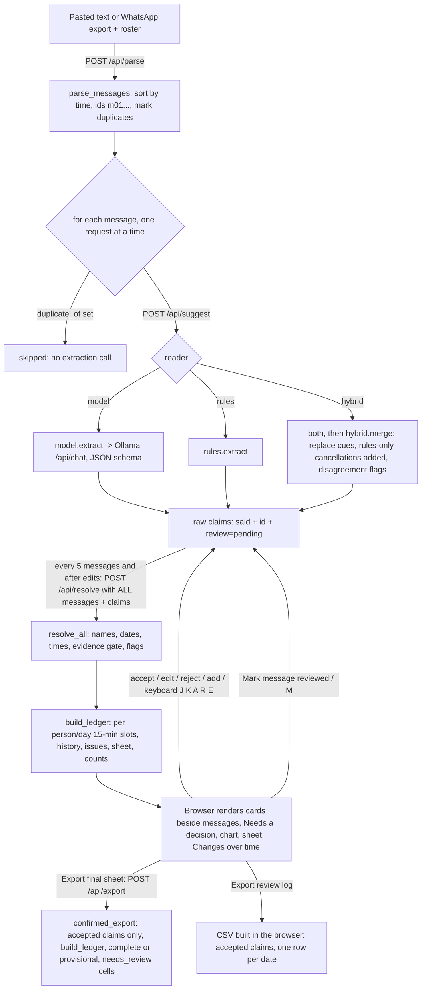

# Architecture

This describes the system **as it exists in the source on 2026-10-20**. Proposed changes are in clearly marked sections at the end. Status words (Implemented, Verified, Partial, Planned, Unverified, Deferred) mean the same as in [PROGRESS.md](../PROGRESS.md#status-vocabulary).

Related: [API.md](API.md) (interfaces), [DECISIONS.md](DECISIONS.md) (why it is built this way), [PRD.md](PRD.md) (intended behaviour), [INTEGRATIONS.md](INTEGRATIONS.md) (planned supporting services and gates), [COMPETITION.md](COMPETITION.md) (verified competition evidence). Start with [context.md](../context.md) and [CLAUDE.md](../CLAUDE.md).

## 1. System overview

Availability Ledger is a single-user, local web tool. A coordinator pastes dated chat messages and a volunteer roster, picks a week, and gets **suggested availability records**. Each suggestion is shown beside the message it came from, and the coordinator accepts, edits or rejects it. The tool builds a per-person, per-day history, a sheet of who is available when, a half-hourly count chart and two CSV exports: the accepted-only reconciled final sheet and the separate review log.

It records **availability** (when someone says they can or cannot help). It does not assign anyone to a shift. There is no shift, rota or assignment object anywhere in the code.

The central design rule: **a local open model only copies phrases out of each message.** Ordinary Python decides everything else:

| Responsibility | Done by | Where |
|---|---|---|
| Copy who / which day words / which time words / status / condition / quote | Model (Ollama) or keyword rules | `ledger/model.py`, `ledger/rules.py` |
| Cross-check model against rules | Code | `ledger/hybrid.py` |
| Match names to the roster | Code | `ledger/names.py` |
| Turn day and time phrases into dates and times | Code | `ledger/resolve.py` |
| Check the quote and phrases against the message; flag unsupported words; drop claims with neither in the message | Code | `ledger/core.py` (`resolve_claim`) |
| Per-person, per-day history; corrections; cancellations; conditions; conflicts | Code | `ledger/core.py` (`build_ledger`) |
| Counts per half hour | Code | `ledger/core.py` (`build_ledger`) |
| Accept / edit / reject, export | The coordinator, in the browser | `ui/app.js` |

## 2. Repository map

```
server.py              HTTP server (stdlib http.server), binds 127.0.0.1, serves ui/ and /api/*
ui/index.html          single page
ui/app.js              all browser state, rendering, review, keyboard shortcuts, CSV export
ui/style.css           styles (light and dark via prefers-color-scheme)
ledger/messages.py     Message type; parse pasted text / WhatsApp exports; roster parsing; duplicate marking
ledger/names.py        roster matching; similar names flagged, never merged
ledger/resolve.py      Calendar; day phrases -> dates; time phrases -> times (no model)
ledger/core.py         claim resolution, evidence gate, ledger/history, counts, evaluation helpers
ledger/export.py       confirmed final sheet (accepted records only), its CSV writer and strict reader
ledger/model.py        Ollama /api/chat call with a JSON schema; prompt v3 (SYSTEM + EXAMPLES)
ledger/rules.py        keyword/regex baseline extractor
ledger/hybrid.py       model + rules merge and cross-check flags
tests/                 49 unittest checks (stdlib only): test_ledger.py, test_export.py; browser/session_rerun.mjs (optional, Node + Chrome)
evaluation/            scoring scripts, results, cached model outputs, tuning and measurement notes
fixtures/              FICTIONAL message sets A and B, rosters, hand-written references, manual-entry CSV template
```

A local Git repository exists, on `main` tracking `origin/main` at the audited HEAD `4c1f700`. The working tree includes modified and untracked implementation/docs; a clone of committed HEAD does not reproduce all current features. Remote accessibility was not verified. There is no package manifest, lock file, Dockerfile, deployment configuration or licence file in the project folder. The application runs on the Python standard library; the browser code uses no external libraries or CDNs. The optional browser harness uses built-in Node APIs and local Chrome.

## 3. Runtime and startup

```
python3 server.py [port]        # default port 8765; host is always 127.0.0.1
```

1. `server.py` starts a `ThreadingHTTPServer` on `127.0.0.1:<port>`. The port is the first command-line argument; nothing is read from `.env` files. `SENTRY_DSN` turns on opt-in tracing when the optional `sentry-sdk` is installed (INT-03, §12). The other environment variables are for the hosted read-only replay (DEP-02): with `LEDGER_DEMO=1` it binds `0.0.0.0:$PORT`, serves fictional set A only and answers suggestions from saved Gemma outputs instead of Ollama ([API: demo mode](API.md#demo-mode-hosted-replay)).
2. The browser loads `/` → `ui/index.html`, `app.js`, `style.css` (sent with `Cache-Control: no-store`).
3. `app.js` calls `GET /api/status`, which asks Ollama at the hard-coded `http://127.0.0.1:11434/api/tags` for installed models (2 s timeout). If Ollama is unreachable the page says only "Rules only" will work.
4. The coordinator loads the fictional demo (`GET /api/demo`) or pastes text, then clicks **Suggest records**.

Ollama is a separate process the user starts (`ollama serve`). The server never starts, installs or downloads anything.

## 4. Frontend / backend relationship

The **server is stateless**. All working state is retained in the browser tab (`state` in `ui/app.js`) and sent to the local Python server with each request, which processes it transiently and keeps nothing. That state is: parsed messages, raw claims with review status and overrides, the last resolved claims and ledger, the roster, the week, the explicit reviewed-message marks, confirmed-export summary, current keyboard card and review statistics. Nothing is written to disk, `localStorage` or a database. **Reloading the page loses all review work.**

The browser sends the complete state on every recompute:



## 5. Model integration

Implemented in `ledger/model.py`:

- Endpoint: `POST http://127.0.0.1:11434/api/chat` (hard-coded constant `OLLAMA`).
- Default model `gemma4:e2b-it-qat` (`DEFAULT_MODEL`); the UI lets the user pick any model Ollama lists. The evaluation also used `qwen3.5:4b-q4_K_M`.
- Request options: `temperature 0`, `seed 7`, `num_ctx 4096`, `think: false`, `keep_alive: "30m"`, `stream: false`, and a JSON schema in `format` (claims array with `person, day_text, time_text, status, condition, replaces_earlier, excerpt`).
- Prompt: `SYSTEM` text plus six invented few-shot `EXAMPLES`; `PROMPT_VERSION = 3`. The user turn contains only the planning week, the send time, the sender and the message text. Earlier messages are **not** sent (see [TUNING.md](../evaluation/TUNING.md)).
- Timeout 300 s per call. **No retries.** If the reply is not valid JSON, `extract` returns no claims and `json_ok: false` in its stats. With the model-only reader the message then has no suggestions; with model + rules the rules' cancellations are still added (flagged) but no availability. Either way the page shows no failure warning (see [TASKS.md](../TASKS.md) COR-03).
- The model never sees the roster and never produces dates.

The rules reader (`ledger/rules.py`) emits the same claim shape. It returns nothing for senders who are not on the roster (for example a coordinator).

## 6. Data structures (from source)

### Message (`ledger/messages.py`)

| Field | Type | Notes |
|---|---|---|
| `id` | str | `m01`, `m02`… assigned after sorting by time (stable for equal times) |
| `sent` | datetime | wall-clock time as written; serialised `"YYYY-MM-DD HH:MM"` |
| `sender` | str | as written |
| `text` | str | continuation lines are joined with `\n` |
| `duplicate_of` | str or null | id of the earliest identical message, see §9 |

### Raw claim (what the browser stores)

```json
{"id": "m04.1", "msg": "m04", "n": 1, "source": "model", "review": "pending",
 "said": {"person": "SENDER", "day_text": "Tuesday", "time_text": "after 3", "status": "available",
          "condition": "", "replaces_earlier": false, "excerpt": "Tuesday after 3 works"},
 "override": {"start": "15:00", "end": "18:00"}, "hints": ["one_reader"]}
```

- `source`: `model`, `rules`, `user` (added by the reviewer) or, in hybrid output, `rules` for claims the cross-check added.
- `review`: `pending`, `accepted`, `rejected`. `dropped` is computed by the server (evidence gate) and is never stored by the browser.
- `override`: reviewer edits (`person`, `dates`, `start`, `end`, `status`, `condition`). Overrides win over `said`.
- `hints`: flags added before resolution (hybrid cross-check).

### Resolved claim (returned by `/api/resolve`)

Adds: `person`, `person_state` (`resolved | ambiguous | unknown`), `person_candidates`, `similar`, `dates` (inside the selected week), `date_state` (`resolved | ambiguous | outside_week | unparsed`), `date_candidates`, `date_note`, `start`, `end`, `time_state` (`explicit | period | open | unstated | unparsed`), `time_note`, `status`, `condition`, `replaces_earlier`, `excerpt_state` (`exact | approx | missing | user`), `excerpt_span` (character offsets into the message, used for highlighting), `flags`, and `drop_reason` when dropped. The full flag list is in [API.md](API.md#flags).

### Ledger (returned by `/api/resolve`)

| Key | Meaning |
|---|---|
| `sheet` | `{person: {date: [{status, start, end, claims, review}]}}` — available and conditional segments only |
| `history` | `{"Person|YYYY-MM-DD": [{msg, sent, claim, status, what, span}]}` in message order |
| `issues` | items for "Needs a decision": kinds `who`, `date`, `outside`, `time`, `conflict`, `condition`, `check_wording` (COR-10, non-blocking, D-30), `unanswered_change` (COR-07a, warning only), `cue_replacement` (COR-18, warning only: earlier time removed because of a change word) |
| `review_notes` | `{"Person|date": [text]}` where an unresolved claim might affect that cell |
| `counts` | 08:00–22:00 in 30-minute steps per day: `available` and `conditional` head-counts |

`/api/resolve` also returns `confirmed`, the status of the final-sheet export for the current review marks (see §10).

## 7. Identity, dates, timezones and intervals

- **Identity.** `names.match_person` normalises accents, case and punctuation. "SENDER", "me", "I" mean the sender. A first name shared by several roster entries is **ambiguous** and never guessed. A prefix of at least three letters resolves when exactly one roster first name matches ("Sam" with only Samira Haddad on the roster) and is ambiguous when several do ("Sam" with Sam Okafor and Samira Haddad). Names within edit distance 2 of another roster name get a `similar_name` flag ("Maria Lopez" vs "Marta Lopes"). Unknown people produce a "who" issue and are not applied. The roster is capped at 20 names; extras are silently dropped by the server.
- **Coordinator messages.** A sender whose name contains the word "coordinator", or who is in the optional `coordinators` request list, has self-claims dropped **only when the sender does not resolve to a roster name**. A coordinator who is also on the volunteer roster resolves normally, and their claims are kept. The rules reader returns nothing for any sender not on the roster. The UI never sends `coordinators`, so in the app only the name rule applies.
- **Dates.** `resolve.resolve_day` uses the message's send date and the selected week (must start on a Monday). Bare weekdays mean the selected week's day unless sent after that day had passed during the week. "Next Tuesday" resolves only when "the next one to occur" and "the one in next week" agree; otherwise it is ambiguous. "This Saturday" sent before the selected week is `outside_week`. Numeric dates try M/D and D/M and keep the reading inside the week. "one day this weekend", "either", "or" make the result ambiguous.
- **Day words the model drops.** If the model writes "Saturday" but its quote says "this Saturday" (same weekday, a single consistent modifier, quote really in the message), the modifier is restored and the flag `day_modifier_from_quote` is shown (added 2026-10-20).
- **Quote must support days.** A claim whose quote names other days is narrowed to the quoted days, or dropped if none overlap. If the quote names no day at all, this check is skipped.
- **Evidence gate limits.** A claim is dropped only when neither its quote nor its day/time words are in the message. A real quote with invented day or time words is flagged `phrase_not_in_message` but stays pending and is applied to the provisional sheet (COR-10).
- **Times.** `resolve.resolve_time`: ranges ("10:30 to 1", "6-9", "between 2 and 5"), open-ended ("after 3", "from 4", "4 onwards" → to 20:00; "until 12" → from 09:00), periods (morning 09–12, afternoon 13–17, evening 17–20, all day 09–20). Bare hours 1–7 are read as pm. Point times ("at 9") are **not** guessed: unparsed. "the same / same time / same hours" copies the explicit range of the nearest earlier claim in the same message (never another message); otherwise unparsed with "'the same' needs a time earlier in this message".
- **Timezones.** The timezone field is passed to the server and stored in `Calendar.timezone`, but **no code uses it**. Message timestamps are treated as wall-clock times; nothing is converted. Day boundaries (09:00–20:00) and periods are fixed in code and not configurable from the UI or API.
- **Intervals.** Each person/day is an array of 15-minute slots from 06:00 to 23:00. Each slot holds `(status, claim id, message id, specificity)`. An unavailable claim without a time covers the whole 06:00–23:00 day. An available claim without a time covers 09:00–20:00 if there is no earlier answer for that day, and otherwise counts as a confirmation that changes nothing.

## 8. Corrections, cancellations and history

`build_ledger` processes non-rejected, non-dropped claims in message order. Within one message, claims covering more resolved dates go first, so "all week" is applied before "except Friday" and the narrower claim wins:

- A later claim overwrites only the slots it covers, so a Monday correction never touches Wednesday (test `test_monday_correction_keeps_wednesday`).
- `replaces_earlier` (from the model, the rules' replacement words or the hybrid "instead/actually/now…" cue) first clears that day's slots from other messages.
- Each change is logged per person/day with a reason: `added`, `marked unavailable`, `refined`, `repeated`, `cancelled`, `condition declined`, `condition resolved`, `now available`, `now conditional`, `replaced earlier answer for this day`, `confirmed earlier answer`, `no change`.
- Two claims in the **same** message that disagree about the same slots create a `conflict` issue; the more cautious reading (unavailable > conditional > available) is kept until a person decides.
- Conditional segments still open at the end create a `condition` issue listing the condition text.
- Ambiguous dates, unknown or ambiguous people, and unreadable times are **not applied**. Each creates an issue. Ambiguous dates and ambiguous people also add `review_notes` to the cells they might affect; unreadable times and outside-week days do not.

## 9. Duplicate messages (added 2026-10-20)

`messages.mark_duplicates` marks a message as `duplicate_of` the earliest copy when the sender and the text match after ignoring case, whitespace, curly quotes and dash style, and it was sent within 24 hours of that earliest copy. Duplicates get no extraction call (browser and `/api/suggest` both skip them), are shown greyed out with "Same as mXX", and the ledger records a `repeated` history entry for each day the original applied. A duplicate does not re-apply slots.

## 10. Review state and export

- New suggestions are `pending`. **Pending suggestions already count on the sheet and chart** (the hint says "From all suggestions you have not rejected"). An earlier experiment that held back flagged pending suggestions was removed (see [DECISIONS.md](DECISIONS.md) D-13).
- Accept / Reject / Reset buttons, "Use it anyway" for dropped suggestions, "+ Add a record", field edits (any edit marks the suggestion accepted), and "Accept all suggestions without warnings" (only suggestions whose flags are all informational).
- Keyboard: J/K move, A accept, R reject, E focus the first field, Esc leave a field. Shortcuts do not fire inside inputs, selects or textareas.
- **Message review marks.** "Mark message reviewed" (keyboard `M`) records an explicit decision per message in `state.reviewed`; nothing marks a message automatically. "Accept all and mark reviewed" is offered only when every undecided suggestion in the message is pending, has informational flags only, and has a resolved person, day and time. Duplicates are covered by their original. A re-run clears the marks.
- Statistics (`accepts`, `edits`, `rejects`, `adds`, `bulk`, `marks`, review timer) are kept in memory and shown on export only.
- **Final-sheet export** (`ledger/export.py`, `POST /api/export`): built from **accepted** claims only through the ordinary `build_ledger`, so corrections replay exactly as in the app. It is `complete` only when every non-duplicate message is marked reviewed, nothing is pending and no `who`/`date`/`time`/`conflict` issue is open; otherwise `provisional`. Cells touched by pending claims, blocking issues, or accepted/pending claims of unreviewed messages are `needs_review` (dropped and rejected claims never mark cells); when an unreviewed message's scope is unknown, only the whole-file status shows it. Canonical rules: [specs/final-export.md](specs/final-export.md).
- **Review-log export** is generated in the browser: one row per accepted suggestion per date (plus pending ones if "include records not yet reviewed" is ticked); rejected and dropped are excluded. It is a **record log, not the final sheet**: a cancelled offer and its cancellation both appear, in message order. The file cannot reliably reconstruct the sheet: it has no `replaces_earlier` column, and `evaluation/score_csv.py` replays every row as not replacing anything. Column details and an example: [API.md](API.md#csv-export).

## 11. Errors, retries, interruption

- Every exception inside a POST handler becomes HTTP **400** with `{"error": "<ExceptionType>: <message>"}`; there is no 500 path. Unknown POST paths: 404 JSON. Unknown GET paths: 404 `text/plain` "not found".
- The browser processes messages one request at a time. Since COR-03 (2026-10-20), a request error or an unreadable model reply marks only that message with a warning and reading continues; the status line reports "N of M messages could not be read fully", and failed messages are never offered combined accept-and-review. A successful re-run starts a fresh session; a validation/parse failure before that preserves the old session, as described below. Failed requests are not retried; there is no cancel button or resume.
- Model calls time out after 300 s. If Ollama is down, `/api/suggest` with the model or hybrid reader fails with a 400 (`URLError…`).
- A failed request (including a lost connection to the local server) does **not** erase browser state: claims and decisions already held are kept. Reloading the page clears it; a re-run replaces it only after valid settings and a usable parse have been committed.
- **Re-running Suggest records** reads the proposed week and timezone into local variables, validates the week and parses the input first. Only when the input parses into at least one dated message does it commit the new week, timezone, messages and roster together with an empty review state. A non-Monday week, a parse error or an input with no dated messages leaves the previous session (claims, decisions, marks, settings) unchanged, so an export can never combine old approvals with new settings. A failure later, while reading messages, keeps the new session with the claims read so far.

## 12. Logging and observability

- The server suppresses request logging (`log_message` is a no-op) and prints only its start-up line.
- **Opt-in tracing (INT-03, D-33).** By default nothing is sent anywhere except to Ollama on `127.0.0.1`. With `SENTRY_DSN` set and the optional `sentry-sdk` installed (`requirements-tracing.txt`, into `.venv`), `ledger/tracing.py` sends structural spans to Sentry. Without either, every tracing call is a no-op and `sentry_sdk` is never imported. Demo mode never initialises it.
  - **Spans at the call sites,** not in `ledger/model.py`:
    - `server.py` opens one `gen_ai.invoke_agent` span per browser suggest run. The page sends a random run token, the request's position and the request count; `tracing.Runs` keeps the span open across those requests.
    - Inside the run: one `gen_ai.chat` span per model call (model, Ollama's load/prompt/output times, token counts, JSON-ok, claim count, message position, `error.type` on failure), and `ledger.hybrid_merge`.
    - Resolve, confirmed export, ledger build and final CSV spans join the open run, or form a small `ledger request` transaction.
    - `evaluation/run.py` wraps a run the same way, with a chat span per fresh model call and `ledger.score` / `ledger.build_ledger` stages.
  - **Two allowlists before transmission:**
    1. `transaction_hook` (the SDK's `before_send_transaction`) runs `scrub()`. It rebuilds each transaction from listed fields, span-data keys and value shapes (identifier-like strings only, our own span names).
    2. `clean_envelope()`, in a `CleaningTransport` wrapped around the SDK's transport at init, is the last step before sending:
       - it runs `scrub()` on transaction items again;
       - it rebuilds every streamed v2 span item with the same `_value`/`NAME` rules;
       - it drops spans it can't clean, and every other item type.

    The second layer matters because sentry-sdk 2.72 sends `gen_ai.*` spans (our `chat` spans) as separate streamed items (`stream_gen_ai_spans`, default on, kept for Sentry's Agents view). In 2.72 they are split out after `before_send_transaction`, so layer 1 also covers them today. Layer 2 makes that independent of SDK ordering.
  - **Structural attributes kept on streamed spans**, with fixed value checks:
    - `sentry.op`, `sentry.origin`;
    - `sentry.release` (ours only), `sentry.environment` (`local` only);
    - `sentry.segment.name` (our names only), `sentry.segment.id` (16 hex);
    - `sentry.sdk.name`, `sentry.sdk.version`;
    - `process.runtime.name`, `process.runtime.version`.

    Span fields kept: `trace_id`, `span_id`, `parent_span_id`, `name`, `status`, `is_segment`, `start_timestamp`, `end_timestamp`. Dropped, for example: `server.address`, `user.*`, `thread.*`, and any other key.
  - **Not used:** `before_send_span`. In 2.72 it runs only with `trace_lifecycle="stream"`, and never on the streamed `gen_ai` items. The lifecycle is pinned to `"static"`.
  - **SDK settings:** error events and breadcrumbs are dropped. Default and auto-enabled integrations are off (no logging, HTTP-client, argv or module capture). `send_default_pii=False` and `data_collection` are all off; no local variables or source context; no sessions, client reports or logs.
  - **Test:** `tests/test_tracing.py` sends invented sensitive strings through these paths into a capturing transport and finds none of them.
- Model timing and token counts are returned by `/api/suggest` in `stats` but the UI does not display them. The evaluation scripts record them per message in `evaluation/runs/` and summarise them in result JSON.
- `evaluation/run.py` samples memory with macOS tools (`ps`, `sysctl`, `memory_pressure`, `vm_stat`) and Ollama `/api/ps` while it runs. These are local reads only.

## 13. Data boundaries

| Data | Where it lives | Leaves the machine? |
|---|---|---|
| Pasted messages, roster, claims, review decisions | Retained in browser memory; sent to the local Python server on 127.0.0.1 with each request and processed transiently; no application persistence | No |
| Model prompts and replies | Sent to Ollama on 127.0.0.1 | No |
| Exported CSV | Downloaded by the browser to wherever the user saves it | Only if the user shares it |
| Evaluation caches and results | `evaluation/runs/`, `evaluation/results/` (fictional fixtures only) | No |
| Tracing spans (opt-in, INT-03) | Built in process from allowlisted timing, count, model and stage fields, checked by both allowlists (`scrub()` and `clean_envelope()`) | Only when the user sets `SENTRY_DSN` (to Sentry); never in demo mode |

Runtime integrations today: the local Gemma model, the opt-in Sentry tracing above, and the hosted replay (fictional data, no model calls). Any future runtime service must follow [DECISIONS.md](DECISIONS.md) D-17 and the detailed [integration contracts](INTEGRATIONS.md): opt-in/off by default, verified free allowance, no private content in telemetry, disclosure of external transfers, and no disruption to the local workflow. Development tools and demo narration are separate data paths, not application runtime dependencies.

## 14. Known technical limitations

- No persistence or session save/load; one browser tab is the only copy of review work.
- The review-log export cannot be replayed into the sheet (use the final-sheet export instead); no protection against spreadsheet formula injection in exported text (values starting with `=`, `+`, `-`, `@`).
- Evidence gate: a real quote with invented day or time words is applied provisionally (flagged, pending).
- Pending suggestions count on the sheet and chart, so the sheet is provisional until everything is reviewed.
- Timezone is not used; day start/end and period hours are fixed.
- Model JSON failures produce no visible failure warning (model only: no suggestions; model + rules: only rules-added cancellations).
- Single-message extraction: context from earlier messages is never given to the model; "still on for Saturday" relies on the ledger's confirmation rule.
- Roster capped at 20; names not on the roster are never applied.
- Point times ("at 9") are not read; recurring phrases ("every other Tuesday") are not supported.
- The availability sheet table can overflow its panel horizontally (observed in a 1400 px wide headless screenshot on 2026-10-20).
- Accessibility (screen readers, contrast) has not been checked.
- Tested on macOS with Python 3.15.0 only; the README's "Python 3.10+" is a stated requirement that has not been re-tested.

## 15. Deployment

### Current: local only (Implemented, Verified 2026-10-20)

`python3 server.py` on the coordinator's own computer, with Ollama on the same machine for the model readers. "Rules only" works without Ollama.

### Hosted demo: none (not implemented)

There is no hosted copy, deployment file or public URL. No free hosted Gemma runtime has been selected or verified. The existing server binds to `127.0.0.1`, and its hard-coded Ollama address points to the server's own machine; deploying it as-is does not connect it to Ollama on a coordinator's laptop.

### Agreed demonstration direction (Planned, not built)

The selected direction is an **interactive fictional replay on Render**, subject to free-plan, implementation and deployment approval gates. The existing code has no replay reader or deployment configuration; it would need a deliberately scoped mode that serves **saved Gemma outputs** only for fixed fictional fixtures. It must be labelled "replaying saved Gemma outputs for fictional messages; no model runs here", preserve actual review/correction/export interactions and prevent arbitrary pasted content from entering the hosted model-replay path. A local video remains a permitted submission path if hosting is not ready.

The owner's existing `bipulchamoli.tech` may point to that host after DNS configuration. A domain is an address, not hosting; the project name need not match it. Prize eligibility depends separately on evidence of acquisition through the Hacktoberfest offer. No DNS change, deployment, free-quota verification or public URL is recorded. The optional hosted demo must stop/degrade before charges and contain no pilot data, keys or private transcripts. See [INTEGRATIONS.md](INTEGRATIONS.md), [TASKS.md](../TASKS.md) DEP-02 and [DECISIONS.md](DECISIONS.md) D-19.

## 16. Supporting technology roles (Planned or conditional, not implemented)

The core runtime stays browser → local Python → local Ollama. Supporting technologies have separate purposes and data boundaries; they must not be added as unnecessary dependencies on every coordinator request.

| Path | Intended role and boundary | Gate before use |
|---|---|---|
| Development: Copilot + Actions | Use Copilot on genuine needed coding/review tasks; use Actions for offline regression CI on fictional fixtures. These are distinct evidence routes, not a claim that Actions implies Copilot wrote code. | Record real issues/PRs/reviews and workflow results; verify available free access and avoid private pilot content/secrets. |
| Development: Entire | Capture actual future sessions, decisions and commit checkpoints. No application API or runtime dependency is implied. | Confirm supported agent compatibility and inspect/redact sessions before sharing; never fabricate past use or checkpoints. Transcripts reconstructed from genuinely captured records must retain authentic provenance. |
| Development: Backboard R-CLI | Optional bounded task using an existing local model if compatible and useful. | Verify model compatibility, local routing, external data handling and free allowance. Do not switch application inference to a cloud provider or upload private data to obtain eligibility. |
| Optional runtime diagnostics: Sentry | Allow-listed operational metadata about extraction failure/latency and a documented real debugging/performance finding. No private text, names, quotes, prompts, replies or sensitive raw exceptions. | Explicit dependency/network/privacy architecture decision before code; verify Python/runtime support, default capture behavior, redaction with fictional data, opt-in/off-by-default operation and free quota. **Implemented 2026-10-21 (INT-03, D-33):** `SENTRY_DSN` plus optional `sentry-sdk` 2.72.0; see §12. Real traces and a finding are still to come. |
| Public demo: Render + domain | Fixed fictional saved-output replay with useful review/export interactions, clearly disclosed. Domain supplies DNS only. | Implement and verify the replay boundary, server binding/deployment configuration, cost fail-safe, and domain acquisition/renewal evidence. |
| Public video: ElevenLabs | Narrate a fictional demonstration script; the generated audio is a demo asset. | Verify free entitlement, output-publication rights and required attribution/disclosure. Do not send real messages/audio; in-product voice or transcription is not selected. |

Detailed acceptance/evidence gates are canonical in [INTEGRATIONS.md](INTEGRATIONS.md). Competition eligibility and strategic priority are canonical in [COMPETITION.md](COMPETITION.md). These plans are not evidence of completed integrations or permission to install, claim credits, deploy or publish.

**Core dependency order:** freeze unseen fictional set C before changing behavior, without implementation agents reading it → COR-03/COR-10 failure and evidence safeguards → COR-02 protection in both CSV writers → score C once after planned behavior changes → independent/coordinator validation and matched timing study. Necessary development can create genuine sponsor evidence along the way. Historical A/B results remain post-hoc; no new service or sponsor proof substitutes for a trustworthy confirmed export.
